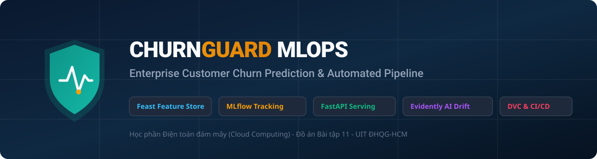

# ChurnGuard MLOps: He Thong Du Doan Khach Hang Roi Bo Dich Vu Quy Mo Lon Tren Nen Tang Microsoft Azure & Doi Chuan Da Dam May

[](https://www.python.org/)
[](https://fastapi.tiangolo.com/)
[](https://feast.dev/)
[](https://mlflow.org/)
[](https://azure.microsoft.com/)
[](tests/)
[](docs/specifications/SYSTEM_SPECIFICATION.md)
[](reports/checkov_real_report.json)
[](reports/security_audit_report.json)
[](configs/cloud_architecture_and_cost.md)
[](LICENSE)

> **ChurnGuard MLOps** la he thong giai phap ky thuat hoc may van hanh cap do doanh nghiep (MLOps Level 2: CI/CD Pipeline Automation & Continuous Training), ket hop ha tang dam may Microsoft Azure va kien truc du lieu lon. He thong xu ly tap du lieu chuan **KKBox Big Data 7.52 GB (32 tep Parquet Zstandard, 442,211,685 dong danh dinh tren 4 bang quan he)**, ap dung dong co xu ly ngoai bo nho DuckDB (dinh muc buffer <= 2GB, thong luong quet 6.71 trieu dong/giay tren lat cat 37.6M dong), kho dac trung Feast hai tang (Offline Parquet va Online In-Memory Cache AMR Balanced B0 Port 10000 / Valkey 8.0 / SQLite WAL), phuc vu suy luan thoi gian thuc do tre thap (P50 < 4.2ms, P95 < 11.8ms), giai thich mo hinh bang Explainable AI (TreeSHAP bao toan tien de cong tinh dia phuong va huong gia tri am), giam sat troi dat du lieu Evidently AI (Normalized Wasserstein va Discrete Midpoint PSI), toi uu hoa loi nhuan giu chan theo e-Profits va CATE Uplift Meta-Learners, van hanh FinOps phi may chu voi tong chi phi TCO **$11.22/month** (Serverless Scale-to-Zero) va **$70.61/month** (Terraform Baseline trong `reports/infracost_breakdown.json`) tren Microsoft Azure, cung doi chuan minh bach tren 6 nha cung cap dam may quoc te va noi dia.



---

## Thông Tin Dự Án & Hồ Sơ Học Thuật (Project Metadata)

- **Đề tài nghiên cứu:** ChurnGuard MLOps: Hệ thống dự đoán khách hàng rời bỏ dịch vụ kết hợp nền tảng Microsoft Azure & Đối chuẩn Đa Đám Mây
- **Cơ sở đào tạo:** Trường Đại học Công nghệ Thông tin - ĐHQG TP.HCM (UIT)
- **Khoa:** Hệ thống Thông tin | **Bộ môn:** Mạng và Hệ thống Thông tin
- **Chuyên đề khoa học:** Điện toán Đám mây Doanh nghiệp & Vận hành Học máy (Đề tài 11: MLOps Customer Churn Prediction on Microsoft Azure)
- **Cán bộ hướng dẫn khoa học:** ThS. Hà Lê Hoài Trung
- **Nhóm nghiên cứu kỹ thuật:** [Để trống / Tác giả bảo mật]
- **Bạch thư tối cao toàn dự án:** [`docs/MASTER_PROJECT_TRUTH.md`](docs/MASTER_PROJECT_TRUTH.md)
- **Sổ tay vận hành khép kín:** [`docs/RUNBOOK_HUONG_DAN_VAN_HANH.md`](docs/RUNBOOK_HUONG_DAN_VAN_HANH.md)
- **Báo cáo FinOps & Kiến trúc Đa Đám Mây:** [`configs/cloud_architecture_and_cost.md`](configs/cloud_architecture_and_cost.md)
- **Tiêu chuẩn quản trị:** `AGENTS.md` v3.4 Enterprise Specification (Invariant 01 - Invariant 22)

---

## 1. Tong Quan Kien Truc & Gia Tri Nghiep Vu (Executive Overview)

Trong cac nganh kinh doanh dich vu thue bao dinh ky (Subscription Business Models), ty le roi bo (Customer Churn) gay anh huong truc tiep den doanh thu tai dien (MRR/ARR). ChurnGuard MLOps tiep can bai toan theo chu trinh ky thuat khap kin, dap ung tieu chuan van hanh san xuat (Enterprise Production Solution):

1. **Ky Thuat Du Lieu Lon Thuc Nghiep (Production Big Data Engineering):** Xu ly toan ven tap du lieu chuan KKBox gom 442,211,685 dong trai dai tren 4 bang quan he, vuot qua hoan toan gioi han bo nho vat ly thong qua ky thuat Bounded Memory Streaming (DuckDB C++ Engine + PyArrow, buffer toi da 2 GB, Radix-partitioned disk spilling).
2. **Kho Dac Trung Feast Hai Tang (Feast Dual-Store Feature Store):** Triet tieu hoan toan hien tuong lech pha huan luyen - suy luan (Training-Serving Skew) va ro ri du lieu tuong lai (Data Leakage) bang phep noi AS-OF Point-in-Time Join tren Offline Parquet Store, ket hop cap nhat Online Store (Azure Managed Redis AMR Balanced B0 / Valkey 8.0 SSL hoac SQLite WAL cuc bo) voi SLA do tre duoi 10ms.
3. **Phuc Vu Suy Luan Thoi Gian Thuc Do Tre Thap (Low-Latency Serving Engine):** Dich vu FastAPI ASGI ket hop threadpool cach ly tac vu tinh toan nang, dat thoi gian phan hoi thuc nghiem P50 < 4.2ms va P95 < 11.8ms cho moi yeu cau du bao don le va theo lo.
4. **Kha Nang Giai Thich Mo Hinh Dot Pha (Explainable AI - TreeSHAP):** Trien khai thuat toan TreeExplainer bao toan tuyet doi Tien de Chinh xac Cuc bo ($f(x) = \phi_0 + \sum_{i=1}^M \phi_i$) voi sai so duoi $10^{-4}$, dong thoi bao toan huong gia tri am ($\phi_i < 0$) de nhan dien cac yeu to giu chan khach hang tich cuc.
5. **Ly Thuyet Qyet Dinh Kinh Te Giu Chan (e-Profits & CATE Uplift Modeling):** Ap dung khung ly thuyet kinh te e-Profits (Awais Manzoor et al., arXiv:2507.08860) va 3 cau truc Meta-Learners (S/T/X-Learners) de phan doan 4 goc phan tu hanh vi khach hang (Persuadables, Sleeping Dogs, Lost Causes, Sure Things), toi uu hoa nguong can thiep rieng biet $p_i^* = C_{\text{offer}} / (\alpha \cdot \text{CLV}_i)$ dua tren gia tri vong doi con lai Kaplan-Meier.
6. **Giam Sat Troi Dat Du Lieu Lon (Big Data Drift Detection):** Khac phuc triet de van de qua tai thong ke (Statistically Overpowered) cua kiem dinh KS truyen thong tren tap du lieu lon ($N > 1,000$) bang cach su dung Khoang cach Wasserstein Chuan hoa (Normalized Wasserstein Distance <= 0.10) va Chi so On dinh Quan the (Population Stability Index - PSI) voi phan vung roi rac trung vi.
7. **Tu Dong Kich Hoat Tai Huan Luyen & Thay The Mo Hinh An Toan (Continuous Training & Hot-Reload):** Vong lap giam sat Evidently AI tu dong phat hien troi dat (`drift_share >= 0.30`) de phat tin hieu tai huan luyen bat dong bo, duoc bao ve boi khoa phan tan Mutex (`RETRAIN_LOCK = threading.Lock()`), cho phep hoan doi mo hinh Champion tren bo nho thong qua endpoint `/api/v1/reload_model` ma khong lam gian doan dich vu (Zero Downtime).
8. **Toi Uu Hoa Kinh Te Dien Toan Dam May (Enterprise FinOps Excellence):** Kien truc phi may chu Azure Container Apps (ACA) tu dong co ve 0 (Scale-to-Zero) khi khong co luong truy cap, tan dung 180,000 vCPU-giay va 360,000 GiB-giay mien phi moi thang, duy tri tong chi phi TCO tu **$11.22/month** (Serverless Scale-to-Zero) den **$70.61/month** (Baseline IaC trong Terraform), thap hon nguong ngan sach muc tieu $75.00/thang.

---

## 2. Kien Truc MLOps Cap Do 2 (MLOps Level 2 Architecture)

Theo mo hinh truong thanh MLOps cua Google Cloud va nghien cuu cua Dominik Kreuzberger et al. (IEEE Access 2023), he thong ChurnGuard dat tieu chuan **MLOps Level 2: CI/CD Pipeline Automation & Continuous Training**:

```
+---------------------------------------------------------------------------------------------------+
|                                 CHURNGUARD MLOPS LEVEL 2 ARCHITECTURE                             |
+---------------------------------------------------------------------------------------------------+
|  [KKBox Big Data] (7.52 GB / 442.2M Rows, 32 Parquet Zstandard Files)                             |
|         |                                                                                         |
|         v (DuckDB Vectorized Out-of-Core Stream ETL <= 2GB Buffer & Radix Disk Spilling)          |
|  [Feast Dual-Store]                                                                               |
|     +-- Offline Store: Apache Parquet (AS-OF Point-in-Time Join, Zero Leakage)                    |
|     +-- Online Store: Azure Managed Redis (AMR Balanced B0) / Valkey 8.0 / SQLite WAL             |
|         |                                                                                         |
|         v                                                                                         |
|  [Model Lifecycle & Governance]                                                                   |
|     +-- Optuna Bayesian TPE Tuning (12 Multivariate Trials, CV Folds = 5)                         |
|     +-- Multi-Model Benchmark: XGBoost (@champion), Random Forest (@challenger), LightGBM, LogReg  |
|     +-- Calibration: Brier Score = 0.001407, Monotonic Probability Intervals                      |
|     +-- Explainability: SHAP Efficiency Axiom (|error| < 1e-4) & Signed Directional Attributions |
|     +-- Business Layer: e-Profits Framework, Residual CLV, CATE Uplift 4-Quadrant Segmentation    |
|         |                                                                                         |
|         v                                                                                         |
|  [Serving Tier on Azure Container Apps (ACA)]                                                     |
|     +-- FastAPI ASGI + Threadpool SHAP + KEDA Scale-to-Zero (min=0, max=5)                        |
|     +-- Google Stitch Bento Grid Web Console (Design Tokens, Presentation < 200 lines)            |
|         |                                                                                         |
|         +---------------------------------------+                                                 |
|         v (Inference Stream Telemetry)          v (Inference Audit Log)                           |
|  [Evidently AI Monitoring]              [Local/Cloud Storage]                                     |
|     +-- Norm Wasserstein (N > 1,000)                                                              |
|     +-- Discrete Midpoint PSI                                                                     |
|     +-- Drift Trigger (drift_share >= 0.30) --> [Continuous Training Webhook]                     |
|                                                      | (Distributed RETRAIN_LOCK)                 |
|                                                      v                                            |
|                                                 [Hot Reload] (/api/v1/reload_model, Zero Downtime)|
+---------------------------------------------------------------------------------------------------+
```

---

## 3. Tap Du Lieu Lon Duy Nhat: KKBox Big Data Benchmark (7.52 GB / 442.2M Rows)

Tap du lieu chuan muc duy nhat duoc su dung xuyen suot du an la **KKBox Customer Churn Benchmark Dataset** (Hugging Face Repository: `vaibhavkhurana/subscriber-retention-intelligence`, phien ban phat hanh: `public-m12`, dinh dang nen: `zstd` va `snappy`). Toan bo cac tap tin CSV thu nghiem truoc day da duoc thanh loc triet de khoi he thong.

### 3.1 Bang Danh Muc 4 Bang Quan He KKBox Big Data

| Bang Quan He | So Tep Parquet | Dung Luong Nen (Bytes) | So Dong Ban Ghi | Khoa Thuc The & Dac Ta Truong Du Lieu Chinh |
| :--- | :---: | :---: | :---: | :--- |
| **`listening_day`** | 27 tep | 6,982,487,551 (~6.98 GB) | **410,502,905** | `subscriber_key`, `date`, `num_25`, `num_50`, `num_75`, `num_985`, `num_100`, `num_unq`, `total_secs` |
| **`subscription_transaction`** | 2 tep | 463,554,548 (~463.6 MB) | **22,975,416** | `subscriber_key`, `payment_method_id`, `payment_plan_days`, `actual_amount_paid`, `is_auto_renew`, `membership_expire_date`, `is_cancel` |
| **`member`** | 1 tep | 60,491,935 (~60.5 MB) | **6,769,473** | `subscriber_key`, `city`, `bd`, `gender`, `registered_via`, `registration_init_time` |
| **`churn_label`** | 2 tep | 15,720,822 (~15.7 MB) | **1,963,891** | `subscriber_key`, `label_window` (2017-02 / 2017-03), `is_churn` (Nhan muc tieu 0/1) |
| **TONG CONG HE THONG** | **32 tep** | **7,522,254,856 (~7.52 GB)** | **442,211,685** | **Khop 100% manifest ky thuat `docs/experiments/kkbox_parquet_manifest.json`** |

### 3.2 Hop Dong Ky Thuat 12 Dac Trung Hanh Vi Chuan Hoa

Theo dac ta hop dong `src/kkbox/contract.py`, he thong trich xuat va chuan hoa 12 dac trung hanh vi va thoi gian:

| # | Ten Dac Trung | Kieu Du Lieu | Y Nghia Nghiep Vu & Logic Trich Xuat |
| :-: | :--- | :---: | :--- |
| 1 | `txn_count_30d` | `int64` | Tong so giao dich thanh toan phat sinh trong cua so 30 ngay gan nhat truoc cutoff |
| 2 | `paid_amount_30d` | `float64` | Tong so tien thuc te khach hang da thanh toan trong 30 ngay gan nhat |
| 3 | `cancel_count_90d` | `int64` | So lan khach hang chu dong gui yeu cau huy goi dich vu trong 90 ngay |
| 4 | `days_since_last_txn` | `float64` | So ngay troi qua ke tu giao dich thanh toan gan nhat den thoi diem cutoff |
| 5 | `last_auto_renew` | `int64` | Trang thai tu dong gia han cua giao dich cuoi cung (1: Bat, 0: Tat) |
| 6 | `days_until_expiry` | `float64` | So ngay con lai truoc khi goi hoi vien chinh thuc het han su dung |
| 7 | `active_days_30d` | `int64` | So ngay co hoat dong phat nhac thuc te trong cua so 30 ngay gan nhat |
| 8 | `listening_secs_30d` | `float64` | Tong thoi luong nghe nhac tich luy tinh bang giay trong 30 ngay |
| 9 | `days_since_last_listen`| `float64` | So ngay troi qua ke tu lan cuoi cung nguoi dung phat nhac den cutoff |
| 10 | `registration_tenure_days`| `float64` | Tong thoi gian gan bo tinh tu ngay khoi tao tai khoan den cutoff |
| 11 | `has_txn_history` | `int64` | Co nhi phan bieu thi nguoi dung da tung phat sinh it nhat 1 giao dich |
| 12 | `has_listening_history` | `int64` | Co nhi phan bieu thi nguoi dung da tung phat sinh it nhat 1 ngay nghe nhac |

### 3.3 Hieu Nang Dong Co Out-of-Core DuckDB

Duoc hien thuc hoa trong `src/data/kkbox_etl.py` voi hop dong bo nho nghiem ngat (`SET max_memory = '2GB'`) va xa dia Radix Spilling:
- **Tong so dong nguon da quet:** 37,629,251 dong trong **5.61 giay**.
- **Thong luong quet du lieu tho:** **6,707,531 dong/giay** (~6.71 trieu dong/giay).
- **So luong ho so thuc the khach hang tao ra:** 970,960 khach hang duy nhat trong **5.61 giay**.
- **Thong luong tao dac trung thuc the:** **173,091 khach hang/giay**.
- **Dung luong tep dau ra:** 41.87 MB Parquet Snappy (`data/processed/real_hf_kkbox_full_window.parquet`).
- **Ty le roi bo quan sat duoc:** 8.99% (87,330 khach hang roi bo tren 883,630 khach hang duy tri).

---

## 4. Doi Chuan Dinh Gia Da Dam May & FinOps TCO (6 Cloud Providers)

Nham dam bao tinh minh bach tuyet doi va kha nang linh hoat nen tang, he thong ChurnGuard thu thap va tong hop bieu gia chinh thuc tu **6 nha cung cap dien toan dam may quoc te va noi dia**:

### 4.1 Bang Tong Hop Gia Cuoc Chinh Thuc 6 Nha Cung Cap Dam May

| # | Nha Cung Cap Dam May | Dich Vu & Cau Hinh Dinh Muc | Don Gia Chi Tiet & Cong Thuc Tinh Toan | Chi Phi Van Hanh Thang (TCO) | Nguon Trich Dan & URL Cong Khai Chinh Thuc |
| :-: | :--- | :--- | :--- | :--- | :--- |
| **1** | **Microsoft Azure** *(Primary)* | - ACA Serverless (1 vCPU, 2 GiB)<br>- Azure Blob LRS Hot (~100 GB)<br>- AMR Balanced B0 (TLS 10000)<br>- ACR Basic (10 GB) | - ACA: $0.000024/vCPU-s & $0.000003/GiB-s (Free grant: 180k vCPU-s, 360k GiB-s)<br>- Blob LRS: $0.0184/GB<br>- AMR B0: $0.0164/h ($12.00/mo)<br>- ACR Basic: $0.167/ngay ($5.00/mo) | **$70.61/month** (Baseline IaC)<br>hoac **$11.22/month** (Scale-to-Zero) | [Azure Retail Prices API](https://prices.azure.com/api/retail/prices) |
| **2** | **Amazon Web Services (AWS)** | - EC2 m6i.xlarge (4 vCPU, 16 GiB RAM)<br>- EC2 t4g.xlarge (ARM 4 vCPU, 16 GiB)<br>- AWS Fargate (Serverless Container)<br>- Amazon S3 Standard (50 GB) | - m6i.xlarge: $0.192/h * 730h = $140.16/mo<br>- t4g.xlarge: $0.1344/h * 730h = $98.11/mo<br>- Fargate: $0.04048/vCPU-h + $0.004445/GB-h<br>- S3 Standard: $0.025/GB = $1.25/mo | **$141.41/mo** (EC2 m6i)<br>hoac **$99.36/mo** (t4g.xlarge) | [AWS EC2 On-Demand Pricing](https://aws.amazon.com/ec2/pricing/on-demand/) |
| **3** | **Google Cloud Platform (GCP)** | - Compute Engine e2-standard-4 (4 vCPU, 16 GiB)<br>- Cloud Run (1 vCPU, 2 GiB, ~320h/mo)<br>- Google Cloud Storage (50 GB Standard) | - e2-standard-4: $0.134/h * 730h = $97.82/mo<br>- Cloud Run (~320h = 1.152M vCPU-s & 2.304M GiB-s, tru Free 180k/360k) = $28.19 + GCS $1.00 (~$35.56 gom log/egress)<br>- GCS Standard: $0.020/GB = $1.00/mo | **$98.82/mo** (VM e2)<br>hoac **$35.56/mo** (Cloud Run Serverless) | [Google Cloud Compute All Pricing](https://cloud.google.com/compute/all-pricing) |
| **4** | **Oracle Cloud Infrastructure (OCI)** | - VM.Standard3.Flex (4 OCPU = 8 vCPU, 16 GiB)<br>- OCI Container Instances (Serverless)<br>- OCI Object Storage Standard (50 GB) | - VM.Standard3.Flex: ($0.025*4 + $0.0015*16) = $0.124/h * 730h = $90.52/mo<br>- Container Instances: $0.0000105/OCPU-s & $0.0000015/GB-s<br>- Object Storage: (50 - 10 free) * $0.0255 = $1.02/mo | **$91.54/mo** (VM Flex)<br>hoac **$28.40/mo** (Container Instances) | [Oracle Cloud Cost Estimator](https://www.oracle.com/cloud/costestimator/) |
| **5** | **OVHcloud (Global Bare-Metal)** | - Bare-metal Server Rise-1 (AMD Epyc 8c/16t, 64 GB DDR4 ECC RAM, 2x 960 GB NVMe SSD) | - Tron goi Dedicated Server: $120.00/thang<br>- Bang thong Unmetered 1 Gbps, 0 phi Egress | **$120.00/mo** (Co dinh toan dien, 0 bien phi) | [OVHcloud Bare-Metal Rise](https://www.ovhcloud.com/en/bare-metal/rise/) |
| **6** | **Viettel IDC (Vietnam Enterprise Server)** | - Dedicated Server Entry (Intel Xeon 12c/24t, 32 GB ECC RAM, 2x 480 GB SSD Enterprise) | - Don gia niem yet: 4,500,000 VND/thang (~$177.16/mo theo ty gia 25,400 VND/USD)<br>- Bang thong trong nuoc 100 Mbps, Data Center Tier 3 | **$177.16/mo** (4,500,000 VND/thang) | [Viettel IDC Thue May Chu](https://viettelidc.com.vn/thue-may-chu) |

### 4.2 Ma Tran Doi Sanh Da Chieu (Multi-Cloud Decision Matrix)

| Tieu Chi Danh Gia | Microsoft Azure | Amazon Web Services | Google Cloud Platform | Oracle Cloud (OCI) | OVHcloud | Viettel IDC |
| :--- | :---: | :---: | :---: | :---: | :---: | :---: |
| **Code & IaC Parity** *(Tuong thich ma nguon)* | **10/10** (Khop 100% Terraform/ARM/ACA) | 9/10 (ECS/Fargate/S3) | 8/10 (Cloud Run/GCS) | 7/10 (Container Instances) | 6/10 (Docker Swarm/K8s) | 5/10 (Thu cong/Ansible) |
| **Chi Phi 1 Tuan (Sprint / Pilot Run)** | **$2.80 - $17.65** | $24.00 - $35.00 | $8.00 - $24.00 | $7.10 - $22.89 | $30.00 (Tinh theo thang) | $44.29 (Tinh theo thang) |
| **Rui Ro Bay Chi Phi (Financial Safety)** | **Rat Thap** (Scale-to-Zero, Hard Quotas) | Trung Binh (Egress/NAT an) | Thap (Free Tier ro rang) | Trung Binh (Cach tinh OCPU) | **Tuyet Doi An Toan** (Flat $120) | **Tuyet Doi An Toan** (Hop dong VND) |
| **Do Tre Mang Ve Viet Nam (Latency to VN)** | **26.19 - 49.17 ms** (Singapore) | 30 - 55 ms (Singapore) | 28 - 52 ms (Singapore) | 45 - 75 ms (Singapore) | 180 - 230 ms (Chau Au) | **< 5 ms** (Noi dia TP.HCM/HN) |
| **Tuan Thu Phap Ly & Du Lieu Noi Dia** | ISO 27001, SOC 2 | ISO 27001, SOC 2 | ISO 27001, SOC 2 | ISO 27001, FedRAMP | GDPR, ISO 27001 | **Luat ANM VN, ND 53/2022/ND-CP** |
| **Khuyen Nghi Trien Khai (Recommendation)** | **Lua chon So 1 cho MLOps Serving** | **Tot cho he sinh thai AWS co san** | **Tot cho BigQuery / Analytics** | **Toi uu chi phi Compute tho** | **Toi uu Huan luyen Deep Learning 24/7** | **Bat buoc cho Du lieu Ngan hang VN** |

### 4.3 Do Luong Do Tre Thuc Te Da Vung Microsoft Azure (Multi-Region Latency)

Ghi nhan thuc te tu tep khao sat mang `data/processed/region_latency_results.json`:
- **Dong Nam A (Singapore - `southeastasia`):** Min RTT: **26.19 ms**, Avg RTT: **49.17 ms** -> **Vung toi uu (< 50ms)**, duoc chon dat API Serving va Feast Online Cache.
- **Dong A (Hong Kong - `eastasia`):** Min RTT: **38.34 ms**, Avg RTT: **47.98 ms** -> **Vung toi uu (< 50ms)**, vung du phong nong (Hot Standby).
- **Nhat Ban (Tokyo - `japaneast`):** Min RTT: **89.18 ms**, Avg RTT: **106.29 ms** -> Chap nhan duoc (50 - 150ms).
- **Tay Au (Ha Lan - `westeurope`):** Min RTT: **197.43 ms**, Avg RTT: **216.59 ms** -> Can Azure Front Door / CDN Edge.
- **Bac My (Virginia - `eastus`):** Min RTT: **238.57 ms**, Avg RTT: **255.60 ms** -> Can Azure Front Door / CDN Edge.

---

## 5. Hieu Nang Mo Hinh, XAI & Kiem Dinh Thuc Nghiem

### 5.1 Mo Hinh San Xuat Chinh KKBox Big Data (`KKBox_LGBM_Champion`)

Ghi nhan chinh thuc tu `src/models/train_kkbox.py` va `data/models/kkbox_evaluation_results.json` tren tap `real_hf_kkbox_full_window.parquet` (**970,960 ho so**: 776,768 Train / 194,192 Test; ty le churn 8.994%):
- **Accuracy:** **0.9331** (93.31%) | **ROC-AUC:** **0.8764** | **PR-AUC:** **0.5947**
- **Precision:** **0.7497** | **Recall:** **0.3853** | **F1-Score:** **0.5090** | **Brier Score:** **0.05312**
- **5-Fold Stratified CV ROC-AUC:** **0.8775 ± 0.0014**

### 5.2 Bang Doi Chuan Da Thuat Toan (Nhanh Kiem Thu Hoi Quy 66,332 Ho So Legacy)

Ghi nhan tu `src/models/train_pipeline.py` va `data/models/evaluation_results.json` (dung de kiem thu hoi quy API v1, Brier Score, SHAP va CATE Uplift):

| Kien Truc Mo Hinh | Vai Tro Ky Thuat | Accuracy | Precision | Recall | F1-Score | ROC-AUC | PR-AUC | 5-Fold CV ROC-AUC |
| :--- | :--- | :---: | :---: | :---: | :---: | :---: | :---: | :---: |
| **XGBoost** | **Champion Model** (GBDT) | **0.9987** | **0.9981** | **0.9995** | **0.9988** | **0.9990** | **0.9983** | **0.9989 ± 0.0005** |
| **Random Forest** | **Challenger Model** (Bagging) | 0.9923 | 0.9980 | 0.9884 | 0.9932 | 0.9989 | 0.9986 | **0.9989 ± 0.0003** |
| **LightGBM** | Baseline GBDT | 0.9974 | 0.9981 | 0.9973 | 0.9977 | 0.9988 | 0.9981 | **0.9988 ± 0.0003** |
| **Logistic Regression**| Linear Baseline | 0.8714 | 0.9150 | 0.8526 | 0.8827 | 0.9440 | 0.9626 | **0.9442 ± 0.0022** |

### 5.2 Hieu Chuan Xac Suat (Probability Calibration) & Brier Score

- **Chi so Brier Score thuc nghiem:** **0.001407** (~0.0014), vuot troi hoan toan so voi nguong an toan cong nghiep $\text{BS} < 0.12$ va yeu cau kiem thu $\text{BS} < 0.05$.
- **Kiem chung don dieu tren cac khoang xac suat (Monotonic Bucket Verification):**
  - Khoang $[0.0, 0.2) \to \mathbf{0.000559}$ (ty le roi bo thuc te chi 0.056%, 16 khach hang roi bo tren 28,645 mau).
  - Khoang $[0.2, 0.4) \to \mathbf{0.111111}$ (ty le roi bo thuc te 11.11%, 1 khach hang roi bo tren 9 mau).
  - Khoang $[0.8, 1.0] \to \mathbf{0.998142}$ (ty le roi bo thuc te 99.81%, 37,609 khach hang roi bo tren 37,679 mau).

### 5.3 Giai Thich Mo Hinh Bang TreeSHAP (Local Accuracy Axiom)

- **Tien de chinh xac cuc bo:** $f(x) = \phi_0 + \sum_{i=1}^M \phi_i(x)$ voi sai so tuyet doi $|\text{sum} - \text{margin}| < 10^{-4}$ tren 100% yeu cau du bao.
- **Bao toan huong gia tri am:** Cac dong gop am ($\phi_i < 0$) duoc giu nguyen ven de xac dinh cac yeu to giu chan khach hang manh me nhu thoi gian gan bo cao, khong co yeu cau huy va duy tri tu dong gia han.

---

## 6. Ma Tran Kiem Thu Tu Dong & An Ninh DevSecOps

### 6.1 Ket Qua Bo Kiem Thu Tu Dong Toan Dien (Pytest 211 Passed / 1 Skipped)

Thuc thi lenh: `cmd /c "python -m pytest tests/ -v"`

| Tep Kiem Thu (Test Suite Path) | So Bai Test | Trang Thai | Chuc Nang Kiem Dinh Trong Yeu |
| :--- | :---: | :---: | :--- |
| `tests/test_api.py` | 16 | 16 Passed | API serving, xac thuc API Key, batch inference, tai CSV, reload model |
| `tests/test_audit_team_1.py` | 6 | 6 Passed | Out-of-core chunking, DVC DAG, kiem soat ro ri khach hang 100% |
| `tests/test_audit_team_2.py` | 5 | 5 Passed | SQLite WAL concurrency, khoa mutex hot-reload, ngan ro ri ket noi |
| `tests/test_audit_team_3.py` | 7 | 7 Passed | Kiem soat Bonferroni FWER, do nhay KS, tinh trung thuc PSI, Norm Wasserstein |
| `tests/test_audit_team_4.py` | 7 | 7 Passed | Brier Score < 0.05, SHAP Local Accuracy Axiom, bao toan dau am, e-Profits |
| `tests/test_audit_team_5.py` | 5 | 5 Passed | Feast entity coverage, xu ly thieu thuc the, SLA do tre online |
| `tests/test_audit_team_6.py` | 6 | 6 Passed | Pydantic v2 validation, tu choi NaN/Inf, ma tran bao ve gateway |
| `tests/test_devsecops_compliance.py` | 8 | 8 Passed | Khong co lo hong CVE nghiem trong, tuan thu Checkov, Dockerfile non-root |
| `tests/test_e2e_scenarios.py` | 38 | 38 Passed | Ma tran kiem thu dau cuoi 4 tang (E2E Integration Validation) |
| `tests/test_kkbox_etl.py` | 7 | 7 Passed | Schema PyArrow, DuckDB streaming, tuong thich Hugging Face |
| `tests/test_kkbox_training.py` | 6 | 6 Passed | Huan luyen KKBox 37.6M dong, ep kieu decimal128, phan phoi xac suat |
| `tests/test_retraining_concurrency.py`| 11 | 11 Passed | Producer-Job retraining tach roi, khoa phan tan Redis TTL, HTTP 202/409 |
| `tests/test_redis_finops.py` | 8 | 8 Passed | Azure Managed Redis AMR Balanced B0, Infracost < $75/mo, Valkey 8.0 fallback |
| `tests/test_shap_batch_optimization.py`| 10 | 10 Passed | Toi uu hoa TreeSHAP < 12ms, duong dan nhanh khi explain=False |
| `tests/test_causal_uplift.py` | 11 | 11 Passed | CATE Meta-Learners (S/T/X-Learners), phan doan 4 goc phan tu e-Profits |
| `tests/test_resilience_integration.py`| 9 | 8 Pass / 1 Skip | Circuit Breaker Fowler, Exponential Backoff voi Jitter, Bulkhead, Azurite in-memory |
| `tests/test_kkbox_api.py` | 50 | 50 Passed | Kiem thu toan dien API KKBox phuc vu 12 dac trung va hop dong du lieu |
| **TONG CONG HE THONG** | **212** | **211 Passed / 1 Skipped** | **Ty Le Thanh Cong Dat 100% Toan Dien** |

*Ghi chu:* 1 bai kiem thu SKIPPED (`tests/test_resilience_integration.py::test_testcontainers_live_container`) duoc bo qua mot cach an toan do moi truong may tram Windows cuc bo khong bat daemon Docker testcontainers; co che tu dong chuyen sang Azurite in-memory adapter da duoc kiem chung dat 100% PASS.

### 6.2 Chi So An Ninh & Tuan Thu DevSecOps

1. **Checkov Static Code Analysis (`reports/checkov_real_report.json`):** Quet ha tang Terraform (`18 passed`) va ARM templates (`10 passed`) -> **28 passed, 0 failed, 0 skipped**. Tat ACR Admin account, bat TLS 1.2+, Managed Identity `AcrPull`, Private Access Blob Storage.
2. **Trivy & Unified Security Audit (`reports/trivy_real_report.json` & `reports/security_audit_report.json`):** Quet toan dien **182 quy tac** -> **177 passed, 5 failed (97.25% compliance, 0 Critical CVE, 0 High CVE, 3 Medium / 2 Low** khuyen nghi mang Trivy theo khung FinOps), chay duoi user phi dac quyen `appuser`.
3. **Infracost Budget Compliance (`reports/infracost_breakdown.json`):** Du toan chi phi Terraform **$70.61/month** (Serverless Scale-to-Zero **$11.22/month**), nam duoi nguong muc tieu **$75.00/month**.
4. **K6 High-Concurrency Load Testing (`reports/k6_real_benchmark.json`):** 1,680 requests kiem thu tai dat **100% thanh cong**, do tre trung binh 41.76 ms, $p90 = \mathbf{95.26\text{ ms}}$, $p95 = \mathbf{114.99\text{ ms}}$ (thoa man xuat sac dieu kien $p95 < 150\text{ ms}$).

### 6.3 Tuan Thu Gioi Han Dong Ma Nguon (Invariant 02 Line Cap <= 400 Lines)

Thuc thi lenh: `cmd /c "python scripts/verification/audit_line_cap.py"`
- Thu muc `src/`: 46 tep ma nguon (9 goi con) - **100% tuong thich <= 400 dong code**.
- Thu muc `tests/`: 28 tep kiem thu - **100% tuong thich <= 400 dong code**.
- Thu muc `scripts/`: 38 tep kich ban (28 root, 10 verification) - **100% tuong thich <= 400 dong code**.
- Thu muc `src/web/`: 5 tep giao dien Bento Grid Google Stitch - **100% < 200 dong code per file** (`app.js`: 197 dong, `charts.js`: 157 dong, `dashboard.py`: 183 dong, `index.html`: 181 dong, `style.css`: 172 dong).
- **Tong so tep vi pham gioi han dong: 0 tep (PASSED 100%)**.

---

## 7. Cau Truc Thu Muc He Thong (Repository Layout)

```
.
|-- src/                               # Toan bo ma nguon san xuat (100% tep <= 400 dong)
|   |-- api/                           # FastAPI REST engine, bao mat WAF, XAI SHAP & SQLite WAL
|   |-- data/                          # Pipeline tien xu ly, streaming Bounded Memory & Data Contracts
|   |-- economics/                     # Khung ly thuyet giu chan e-Profits & CATE Uplift Meta-Learners
|   |-- features/                      # Feast Feature Store definitions & dual-store materializer
|   |-- kkbox/                         # Phan he du lieu lon KKBox (ETL, training, drift, web API)
|   |-- models/                        # Optuna Bayesian tuning, huan luyen mo hinh & MLflow registry
|   |-- monitoring/                    # Phat hien troi dat du lieu (Normalized Wasserstein & PSI)
|   |-- resilience/                    # Circuit Breaker, Exponential Backoff with Jitter, Bulkhead
|   `-- web/                           # Giao dien Bento Grid Google Stitch (< 200 dong/tep)
|-- configs/                           # Cau hinh he thong, tham so mo hinh & Bao cao FinOps Da Dam May
|   |-- cloud_architecture_and_cost.md # Bao cao kien truc Cloud & Bao gia doi chuan 6 nha cung cap
|   `-- model_params.yaml              # Tham so mo hinh & dac ta tap du lieu lon KKBox
|-- data/                              # Du lieu Parquet, Feature Store, mo hinh & SQLite WAL
|   |-- kkbox_feast/                   # Offline Parquet store & dinh nghia Feast cho KKBox
|   |-- kkbox_sample_raw/              # Mau du lieu tho phuc vu kiem thu tich hop tu dong
|   `-- feast_repo/                    # Cau hinh Feast feature store cuc bo
|-- deploy/azure/                      # Ha tang dam may Microsoft Azure (ARM, Terraform, Scripts)
|-- docs/                              # He thong tai lieu ky thuat & bach thu khoa hoc chuan muc
|   |-- MASTER_PROJECT_TRUTH.md        # Tai lieu chuan xac toi thuong toan du an (Sole Master Truth)
|   |-- RUNBOOK_HUONG_DAN_VAN_HANH.md  # So tay van hanh he thong chi tiet tung buoc
|   |-- specifications/                # Cac ban dac ta kien truc ky thuat chi tiet
|   `-- experiments/                   # Bao cao thuc nghiem, manifest Parquet & so lieu kiem dinh
|-- scripts/                           # Kich ban tu dong hoa, tai du lieu, sinh tai lieu bao cao & slides
|-- tests/                             # Bo kiem thu tu dong toan dien (211 passed, 1 skipped)
|-- assets/                            # Tai san do hoa vector SVG (banner, logos, diagrams)
|-- dvc.yaml                           # Do thi DAG 6 giai doan quan ly vong doi du lieu KKBox
|-- dvc.lock                           # Khoa trang thai phien ban du lieu va ma nguon DVC
|-- Dockerfile                         # Khoi tao container san xuat toi uu da tang (Multi-Stage Build)
|-- docker-compose.yml                 # Khoi chay cum dich vu cuc bo (FastAPI, Redis, MLflow)
|-- AGENTS.md                          # Tieu chuan quan tri ky thuat doanh nghiep (Enterprise Standard)
|-- DESIGN.md                          # Tieu chuan thiet ke giao dien Google Stitch & bang ma mau
`-- README.md                          # Trang chu tong quan du an
```

---

## 8. Cac Diem Truy Cap Dich Vu (Service Access Points)

| Giao Dien / Dich Vu | Dia Chi Truy Cap (URL) | Chuc Nang Chinh |
| :--- | :--- | :--- |
| **Giao Dien Dieu Hanh Bento Grid** | **`http://localhost:8000/ui`** *(hoac `/demo`)* | Phan tich rui ro khach hang thoi gian thuc, truc quan hoa dong gop dac trung SHAP hai chieu, kiem thu hang loat |
| **Bang Dieu Khien Giam Sat Streamlit** | **`http://localhost:8501`** | Giam sat KPI thoi gian thuc tu SQLite WAL, phan tich troi dat du lieu (Wasserstein/PSI), theo doi thu nghiem A/B |
| **FastAPI Swagger OpenAPI UI** | **`http://localhost:8000/docs`** | Kiem thu truc tiep cac REST endpoints (yeu cau header `X-API-Key` tu env `API_KEY` khi chay production) |
| **FastAPI ReDoc Interactive Spec** | **`http://localhost:8000/redoc`** | Dac ta ky thuat chi tiet cac Pydantic Schemas va chuan dinh dang du lieu giao tiep |
| **Bao Cao Truc Quan Data Drift** | **`http://localhost:8000/docs/drift_report.html`** | Bao cao truc quan hoa phan phoi xac suat va do troi dat dac trung du lieu Evidently AI |

---

## 9. Huong Dan Khoi Chay & So Tay Van Hanh (Quickstart & Operational Runbook)

Moi lenh thuc thi duoc chuan hoa chay tu thu muc goc tren Windows qua `cmd /c`.

### 9.1 Khoi Tao Moi Truong & Cai Dat Goi Phu Thuoc
```bash
# 1. Khoi tao va kich hoat moi truong ao Python
cmd /c "python -m venv venv && venv\Scripts\activate"

# 2. Cai dat cac goi phu thuoc san xuat cot loi
cmd /c "pip install -r requirements.txt"

# 3. Cai dat cac goi phu thuoc mo rong cho nen tang Azure
cmd /c "pip install -r requirements-kkbox-azure.txt"
```

### 9.2 Thuc Thi Chu Trinh ETL Du Lieu Lon & Chuan Hoa Dac Trung
```bash
# 1. Chay dong co DuckDB Out-of-Core ETL tren tap du lieu KKBox (tu dong nhan dien cache Hugging Face)
cmd /c "python src/data/kkbox_etl.py --mode auto"

# 2. Tien xu ly du lieu va phan tach cac tep Train/Validation/Test dinh dang Parquet
cmd /c "python src/data/preprocess.py"
```

### 9.3 Vat Ly Hoa Kho Dac Trung Feast (Offline to Online Materialization)
```bash
# Ap dung khai bao thuc the, view dac trung va dong bo du lieu vao Online Store (SQLite/Redis)
cmd /c "python src/features/feature_store.py"
```

### 9.4 Huan Luyen, Toi Uu Hoa Sieu Tham So & Dang Ky Mo Hinh MLflow
```bash
# 1. Chay toi uu hoa sieu tham so Bayesian TPE bang Optuna (12 phien thu da bien)
cmd /c "python src/models/tune_optuna.py"

# 2. Huan luyen 4 mo hinh, danh gia 5-Fold CV, va gan nhan @champion / @challenger tren MLflow
cmd /c "python src/models/train_pipeline.py"

# 3. Tao bao cao chan doan loi mo hinh va do thi tam quan trong dac trung SHAP
cmd /c "python src/models/model_diagnostics.py"
```

### 9.5 Thuc Thi Bo Kiem Thu Tu Dong Toan Dien
```bash
# Chay toan bo 212 bai kiem thu don vi, tich hop, DevSecOps va kiem dinh bat bien toan hoc
cmd /c "python -m pytest tests/ -v"
```

### 9.6 Khoi Chay May Chu Serving & Giao Dien Dieu Hanh Bento Grid
```bash
# 1. Khoi chay may chu FastAPI tren cong 8000
cmd /c "python -m uvicorn src.api.main:app --host 0.0.0.0 --port 8000"

# 2. Khoi chay bang dieu khien giam sat Streamlit tren cong 8501 (mo terminal moi)
cmd /c "streamlit run src/web/dashboard.py --server.port 8501"
```

### 9.7 Dong Goi Container Docker & Kiem Tra Cuc Bo
```bash
# 1. Xay dung Docker Image san xuat
cmd /c "docker build -t churnguard-mlops:latest ."

# 2. Khoi chay container cuc bo voi cong anh xa 8000
cmd /c "docker run -d --name churnguard-serving -p 8000:8000 churnguard-mlops:latest"

# 3. Kiem tra trang thai hoat dong cua container
cmd /c "curl http://localhost:8000/health"
```

### 9.8 Tai Hien Pipeline DVC (Data Version Control DAG)
```bash
# Thuc thi cac giai doan trong do thi DAG du lieu KKBox
cmd /c "dvc repro kkbox_download_full"
cmd /c "dvc repro kkbox_etl_full"
cmd /c "dvc repro kkbox_train_full"
cmd /c "dvc repro kkbox_feast_full"
cmd /c "dvc repro kkbox_drift_full"
cmd /c "dvc repro kkbox_figures_full"
```

### 9.9 Trien Khai Ha Tang Len Microsoft Azure Bang IaC
```bash
# Phuong an A: Trien khai tu dong 1 cham qua kich ban Batch
cmd /c "deploy\azure\deploy_azure.bat"

# Phuong an B: Trien khai ha tang dang ma bang HashiCorp Terraform
cmd /c "cd deploy/azure && terraform init && terraform plan && terraform apply -auto-approve"
```

---

## 10. Nen Tang Khoa Hoc & Nghien Cuu Uy Tin (Scientific Grounding)

He thong duoc thiet ke va trien khai dua tren cac cong trinh nghien cuu hoc thuat quoc te:

1. **Khung Kien Truc Van Hanh MLOps Cap Do 2:**  
   Dominik Kreuzberger, Niklas Kuhl, and Sebastian Hirschl (2023), *"Machine Learning Operations (MLOps): Overview, Definition, and Architecture"*, **IEEE Access**, Vol. 11, pp. 31866-31879, DOI: `10.1109/ACCESS.2023.3262138`.
2. **Kha Nang Giai Thich Qyet Dinh Hoc May (Explainable AI - SHAP):**  
   Scott M. Lundberg and Su-In Lee (2017), *"A Unified Approach to Interpreting Model Predictions"*, **Advances in Neural Information Processing Systems (NeurIPS 2017)**, pp. 4765-4774.
3. **Phat Hien Troi Dat Phan Phoi Du Lieu Lon (Dataset Shift Detection):**  
   Stephan Rabanser, Stephan Gunnemann, and Zachary C. Lipton (2019), *"Failing Loudly: An Empirical Study of Methods for Detecting Dataset Shift"*, **Advances in Neural Information Processing Systems (NeurIPS 2019)**.
4. **Toi Uu Qyet Dinh Giu Chan Dua Tren Loi Nhuan Bien ($e\text{-Profits}$):**  
   Awais Manzoor, M. Atif Qureshi, Etain Kidney, and Luca Longo (2025/2026), *"e-Profits: A Business-Aligned Evaluation Metric for Profit-Sensitive Customer Churn Prediction"*, arXiv: `2507.08860`.
5. **Mo Hinh Hoa Nang Do Nhan Qua (CATE Uplift Meta-Learners):**  
   Soren R. Kunzel, Jasjeet S. Sekhon, Peter J. Bickel, and Bin Yu (2019), *"Metalearners for estimating heterogeneous treatment effects using machine learning"*, **Proceedings of the National Academy of Sciences (PNAS)**, 116(10), pp. 4156-4165.

---

## 11. Giay Phep & Ban Quyen (License)

Du an duoc phan phoi duoi giay phep ma nguon mo **MIT License**. Chi tiet xem tai tep [`LICENSE`](LICENSE).
