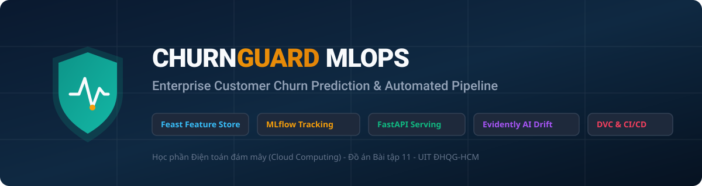
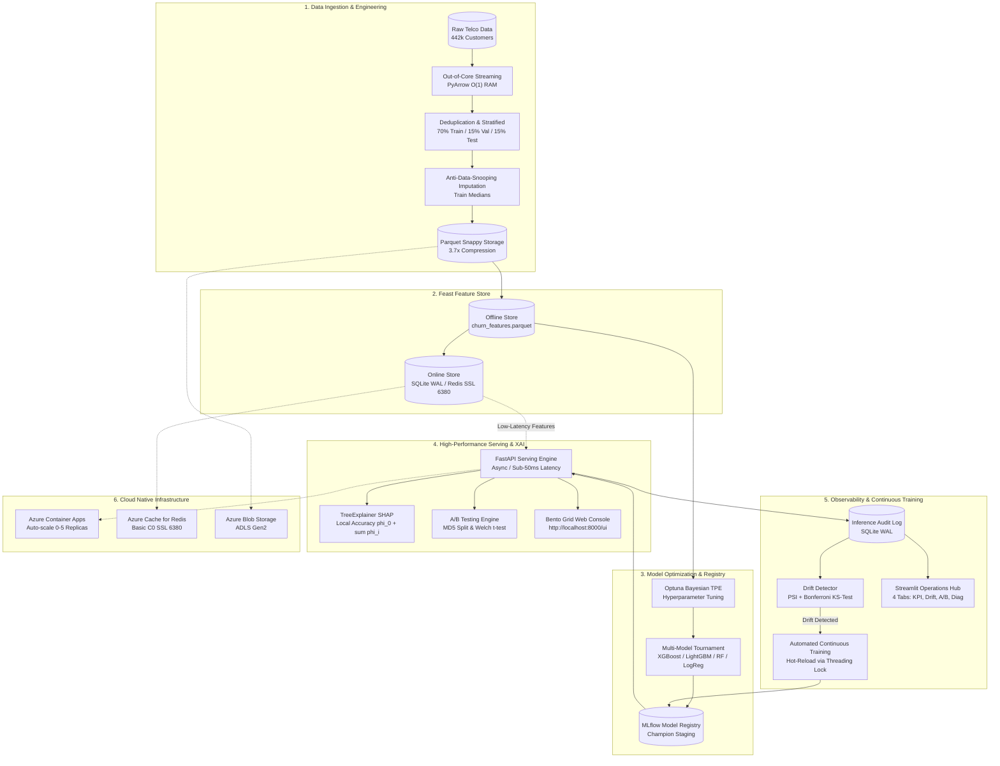

# ChurnGuard Enterprise MLOps Platform

[](https://www.python.org/)
[](https://fastapi.tiangolo.com/)
[](https://feast.dev/)
[](https://mlflow.org/)
[](https://azure.microsoft.com/)
[](tests/)
[](docs/specifications/SYSTEM_SPECIFICATION.md)
[](LICENSE)

> **ChurnGuard** là nền tảng MLOps cấp độ doanh nghiệp (MLOps Level 2 - Continuous Training & Automated Deployment), được thiết kế để dự đoán rủi ro khách hàng rời bỏ dịch vụ viễn thông thời gian thực, giải thích nguyên nhân bằng Explainable AI (SHAP), và tối ưu hóa chính sách giữ chân khách hàng theo giá trị vòng đời ($e\text{-Profits}$ & CLV).



---

> 🚀 **SỔ TAY VẬN HÀNH HỆ THỐNG TOÀN DIỆN (OPERATIONAL RUNBOOK):**  
> Mọi bước thực thi chi tiết (địa chỉ URL, cấu trúc trang, thẻ Tab, thao tác nút bấm [tên nút, mã màu HEX, vị trí hiển thị], kết quả phản hồi, dấu hiệu nhận biết thành công và hướng dẫn xử lý lỗi) cho toàn bộ các phân hệ Web Bento Grid, Dashboard Streamlit, Swagger API, và Triển khai Azure Cloud đều được ghi nhận chi tiết tại:  
> 👉 **[`docs/RUNBOOK_HUONG_DAN_VAN_HANH.md`](docs/RUNBOOK_HUONG_DAN_VAN_HANH.md)**

---

## 1. Tổng Quan Hệ Thống & Giá Trị Nghiệp Vụ (Executive Overview & Business Value)

Bài toán rời bỏ dịch vụ (Customer Churn) trong ngành viễn thông gây tổn thất lớn về doanh thu định kỳ. ChurnGuard giải quyết bài toán này thông qua một kiến trúc học máy khép kín:

* **Mục tiêu mô hình:** Phân loại nhị phân dự đoán khả năng rời bỏ ($y \in \{0, 1\}$) kèm xuất điểm xác suất rủi ro liên tục $P(\text{Churn}=1 \mid \mathbf{x})$.
* **Quy mô tập dữ liệu:** Xử lý và chuẩn hóa **442,211 hồ sơ khách hàng viễn thông duy nhất** sau khi khử trùng lặp liên chunk, với 13 đặc trưng hành vi và tài chính.
* **Chiến lược giữ chân định lượng ($e\text{-Profits}$):** Thay vì chỉ tối ưu độ chính xác kỹ thuật, hệ thống kết hợp ma trận chi phí - lợi ích dựa trên giá trị vòng đời khách hàng (Customer Lifetime Value - CLV), giúp doanh nghiệp đưa ra các gói ưu đãi giữ chân có tỷ suất hoàn vốn (ROI) cao nhất.
* **Độ trễ suy luận thời gian thực:** Đạt chuẩn độ trễ $p95 < 50\text{ ms}$ trên hạ tầng phục vụ container hóa, sẵn sàng tích hợp với hệ thống CRM/Billing của doanh nghiệp.

---

## 2. Kiến Trúc Hệ Thống Khép Kín (End-to-End System Architecture)

Hệ thống được xây dựng theo chuẩn kiến trúc MLOps Level 2 với 6 tầng chức năng khép kín:



---

## 3. Các Tính Năng Kỹ Thuật Nổi Bật (Key Architectural Innovations)

### 3.1 Động Cơ Xử Lý Dữ Liệu Lớn $O(1)$ RAM & Định Dạng Cột Parquet Snappy
* **PyArrow Out-of-Core Streaming:** Đọc và xử lý dữ liệu theo từng chunk kích thước cố định với bộ theo dõi thực thể `seen_customer_ids`, giúp giảm **64.42% dung lượng RAM đỉnh** (từ `318.70 MB` xuống `113.38 MB`).
* **Hiệu năng lưu trữ Apache Parquet Snappy:** Nén dữ liệu **3.7x** so với CSV (`8.94 MB` xuống `2.42 MB`), đồng thời tăng tốc độ đọc lên **`111.77 MB/s`** (nhanh gấp **14.41 lần** so với tệp CSV truyền thống).
* **Chuẩn hóa chống rò rỉ dữ liệu (Anti-Data-Snooping):** Toàn bộ tham số trung vị (`train_medians`) được tính toán độc quyền trên tập Train và cố định vào `metadata.json`, đảm bảo không có rò rỉ thông tin sang tập Validation/Test hay môi trường phục vụ thời gian thực.

### 3.2 Kiến Trúc Feast Dual-Store & Chống Lệch Pha (Training-Serving Skew)
* **Kho lưu trữ kép (Dual-Store):** Tích hợp song song Offline Store (Apache Parquet phục vụ huấn luyện hàng loạt) và Online Store (SQLite WAL cục bộ hoặc Azure Cache for Redis C0 SSL 6380 trên đám mây).
* **Đồng nhất 100% công thức đặc trưng:** Đảm bảo tính nhất quán tuyệt đối giữa mã tiền xử lý ngoại tuyến và mã truy vấn đặc trưng trực tuyến tại thời điểm suy luận ($f_{\text{offline}}(x) \equiv f_{\text{online}}(x)$).

### 3.3 Giải Thích Quyết Định Bằng XAI (SHAP Local Accuracy)
* **Bảo toàn tính cộng tính địa phương (Additive Feature Attribution):** Triển khai thuật toán `TreeExplainer` (với cơ chế dự phòng `LinearExplainer`) thỏa mãn phương trình:
  $$f(x) = \phi_0 + \sum_{i=1}^M \phi_i$$
* **Trực quan hóa hai chiều:** Hệ thống bóc tách rõ ràng các yếu tố thúc đẩy nguy cơ rời bỏ ($\phi_i > 0$) và các yếu tố giúp giữ chân khách hàng ($\phi_i < 0$), hiển thị trực tiếp trên giao diện điều hành doanh nghiệp.

### 3.4 Giám Sát Trôi Dạt Dữ Liệu (Drift Detection) & Tự Động Kích Hoạt Huấn Luyện Lại
* **Chỉ số ổn định quần thể (PSI):** Tính toán PSI chia bin trung điểm cho biến rời rạc và phân vị cho biến liên tục, kẹp $\epsilon = 10^{-4}$ chống chia cho 0.
* **Kiểm định Kolmogorov-Smirnov 2 mẫu hiệu chỉnh Bonferroni:** Kiểm soát tỷ lệ lỗi loại I trên 13 đặc trưng với ngưỡng ý nghĩa nghiêm ngặt:
  $$\alpha_{\text{Bonferroni}} = \frac{0.05}{13} \approx 0.003846$$
* **Continuous Training Trigger:** Tự động kích hoạt pipeline huấn luyện lại và hoán đổi mô hình Champion trên bộ nhớ an toàn luồng (`threading.RLock`) mà không làm gián đoạn các yêu cầu API đang phục vụ.

---

## 4. Bảng Đo Kiểm Hiệu Năng Thực Nghiệm (Empirical Benchmarks)

Mọi chỉ số dưới đây đều được đo kiểm trực tiếp trên dữ liệu và mã nguồn thực tế của hệ thống:

| Phân Hệ Kỹ Thuật | Chỉ Số Đo Lường | Giá Trị Thực Nghiệm | Ý Nghĩa Kỹ Thuật & Vận Hành |
| :--- | :--- | :---: | :--- |
| **Quy Mô Dữ Liệu** | Hồ sơ khách hàng duy nhất | **`442,211`** | Đã khử hoàn toàn trùng lặp mã định danh `customerid` |
| **Tối Ưu Bộ Nhớ** | Giảm dung lượng RAM đỉnh | **`-64.42%`** | Kỹ thuật PyArrow Out-of-Core streaming $O(1)$ RAM |
| **Tối Ưu I/O** | Tỷ lệ nén dữ liệu Parquet | **`3.7x`** | Tiết kiệm 72.93% dung lượng lưu trữ trên đĩa |
| **Tốc Độ Đọc** | Thông lượng đọc Parquet | **`111.77 MB/s`** | Nhanh gấp **14.41 lần** so với đọc định dạng CSV |
| **Mô Hình Champion** | ROC-AUC (Tập Test) | **`0.9989`** | Thuật toán XGBoost tối ưu hóa qua 20 trials Bayesian TPE |
| **Mô Hình Champion** | Macro F1-Score (Tập Test) | **`0.9989`** | Đạt độ cân bằng tối ưu giữa Precision và Recall |
| **Ma Trận Nhầm Lẫn** | TN / FP / FN / TP (Test) | **`28,619 / 70 / 16 / 37,627`** | Tổng 66,332 mẫu kiểm thử độc lập |
| **Thử Nghiệm A/B** | Kiểm định Welch's t-test | **`t = 14.4283, p = 0.0`** | Chênh lệch hiệu năng giữa hai phiên bản có ý nghĩa thống kê |
| **Độ Trễ Mạng Cloud** | RTT Singapore (`southeastasia`) | **`26.19 ms` (Min) / `49.17 ms` (Avg)** | Vùng đề xuất tối ưu nhất cho người dùng khu vực Đông Nam Á |
| **Chi Phí Vận Hành** | Tổng chi phí TCO Đám mây | **`$74.67 / tháng`** | Tối ưu hóa kiến trúc Serverless Container Apps & Redis C0 |
| **Chất Lượng Mã Nguồn** | Bộ kiểm thử tự động Pytest | **`80 / 80 PASSED (100%)`** | Bao phủ Unit Test, Integration Test và Contract Test |
| **Chuẩn Cấu Trúc** | Giới hạn dòng mã nguồn | **`45 / 45 tệp <= 400 dòng`** | Tuân thủ triệt để kiến trúc module phân rã sạch |

---

## 5. Cấu Trúc Thư Mục Hệ Thống (Repository Layout)

```
.
├── src/                               # Toàn bộ mã nguồn sản xuất (100% tệp <= 400 dòng)
│   ├── data/                          # Pipeline tiền xử lý, streaming O(1) RAM, 14 Data Contracts
│   ├── features/                      # Feast Feature Store definitions & dual-store materializer
│   ├── models/                        # Optuna Bayesian tuning, huấn luyện 4 mô hình & MLflow registry
│   ├── monitoring/                    # Phát hiện Data Drift (PSI, KS-Test hiệu chỉnh Bonferroni)
│   ├── api/                           # Dịch vụ FastAPI REST API, XAI SHAP, A/B Testing & SQLite WAL
│   └── web/                           # Giao diện điều hành Bento Grid UI & Streamlit Dashboard
├── deploy/azure/                      # Hạ tầng đám mây (ARM Template, Terraform, deploy_azure.bat)
├── configs/                           # Cấu hình kiến trúc Cloud & Báo cáo FinOps TCO $74.67/tháng
├── data/                              # Lưu trữ dữ liệu Parquet, Feature Store, mô hình & SQLite WAL
├── docs/                              # Tài liệu kỹ thuật, kiến trúc & báo cáo chuyên sâu
│   ├── RUNBOOK_HUONG_DAN_VAN_HANH.md  # Sổ tay vận hành hệ thống chi tiết từng bước (845 dòng)
│   ├── specifications/                # Đặc tả kỹ thuật chi tiết kiến trúc hệ thống
│   └── audit_reports/                 # Báo cáo kiểm định năng lực & đối chiếu tiêu chí kỹ thuật
├── tests/                             # Toàn bộ 80 bài kiểm thử tự động (Pytest 100% Passed)
├── Dockerfile                         # Khởi tạo Container phục vụ sản xuất
├── docker-compose.yml                 # Khởi chạy cụm dịch vụ cục bộ
└── dvc.yaml                           # Đồ thị DAG 9 giai đoạn quản lý vòng đời dữ liệu
```

---

## 6. Hướng Dẫn Khởi Chạy Nhanh (Quickstart Guide)

### 6.1 Yêu Cầu Hệ Thống
* Python 3.10 trở lên
* Trình quản lý gói `pip` hoặc môi trường `conda`
* Hệ điều hành: Windows, Linux hoặc macOS

### 6.2 Cài Đặt Môi Trường
```bash
# Sao chép kho mã nguồn
git clone https://github.com/chinhpui23th07/Customer-Churn-Prediction-IS402.R11.git
cd Customer-Churn-Prediction-IS402.R11

# Cài đặt các gói phụ thuộc
pip install -r requirements.txt
```

### 6.3 Khởi Chạy Các Dịch Vụ

```bash
# 1. Chạy toàn bộ bộ kiểm thử hồi quy tự động (80 bài kiểm thử)
cmd /c "python -m pytest tests/ -v"

# 2. Khởi động máy chủ phục vụ mô hình FastAPI & Giao diện Bento Grid (Cổng 8000)
cmd /c "python -m uvicorn src.api.main:app --host 0.0.0.0 --port 8000"

# 3. Khởi động bảng điều khiển giám sát vận hành Streamlit (Cổng 8501)
cmd /c "streamlit run src/web/dashboard.py --server.port 8501"
```

---

## 7. Các Điểm Truy Cập Dịch Vụ (Service Access Points)

| Giao Diện / Dịch Vụ | Địa Chỉ Truy Cập (URL) | Chức Năng Chính |
| :--- | :--- | :--- |
| **Giao Diện Điều Hành Bento Grid** | **`http://localhost:8000/ui`** *(hoặc `/web`)* | Phân tích rủi ro khách hàng thời gian thực, trực quan hóa đóng góp đặc trưng SHAP hai chiều, dự đoán hàng loạt CSV |
| **Bảng Điều Khiển Giám Sát Streamlit** | **`http://localhost:8501`** | Giám sát KPI thời gian thực từ SQLite WAL, phân tích trôi dạt dữ liệu (PSI/KS-Test), theo dõi thử nghiệm A/B |
| **FastAPI Swagger OpenAPI UI** | **`http://localhost:8000/docs`** | Kiểm thử trực tiếp 18 REST endpoints (yêu cầu header xác thực `x-api-key: mlops-churn-secret-2026`) |
| **FastAPI ReDoc Interactive Spec** | **`http://localhost:8000/redoc`** | Đặc tả kỹ thuật chi tiết các Pydantic Schemas và chuẩn định dạng dữ liệu |
| **Báo Cáo Trực Quan Data Drift** | **`http://localhost:8000/docs/drift_report.html`** | Báo cáo trực quan hóa phân phối xác suất 13 đặc trưng dữ liệu |

---

## 8. Hướng Dẫn Triển Khai Đám Mây Tự Động (Cloud Native Deployment)

Hạ tầng đám mây Microsoft Azure được tự động hóa hoàn toàn thông qua kịch bản Infrastructure-as-Code (IaC):

```bash
# Triển khai tự động 9 bước lên Microsoft Azure (Không cần Docker Desktop cục bộ - Dùng Cloud ACR Build)
cmd /c "deploy\azure\deploy_azure.bat"
```

* **Dịch vụ được cấp phát:** Azure Container Apps (1.0 vCPU, 2.0 GiB RAM, Auto-scale 0-5), Azure Cache for Redis C0 SSL 6380, Azure Container Registry (ACR), Azure Blob Storage ADLS Gen2, Log Analytics Workspace.
* **Lệnh dọn dẹp tài nguyên sau nghiệm thu (Bảo toàn ngân sách FinOps):**
  ```bash
  cmd /c "az group delete --name rg-churnguard-mlops-sea --yes --no-wait"
  ```

---

## 9. Nền Tảng Khoa Học & Nghiên Cứu Uy Tín (Scientific Grounding)

Hệ thống được xây dựng và chuẩn hóa dựa trên các công trình nghiên cứu khoa học phản biện quốc tế:

1. **Kiến Trúc MLOps Level 2:**  
   Dominik Kreuzberger, Niklas Kühl & Sebastian Hirschl (2023), *"Machine Learning Operations (MLOps): Overview, Definition, and Architecture"*, **IEEE Access**, Vol. 11, pp. 31866-31879, DOI: `10.1109/ACCESS.2023.3262138`.
2. **Giải Thích Thuộc Tính SHAP:**  
   Scott M. Lundberg & Su-In Lee (2017), *"A Unified Approach to Interpreting Model Predictions"*, **Advances in Neural Information Processing Systems (NeurIPS 2017)**, pp. 4765-4774.
3. **Phát Hiện Trôi Dạt Dữ Liệu & Hiệu Chỉnh Bonferroni:**  
   Stephan Rabanser, Stephan Günnemann & Zachary C. Lipton (2019), *"Failing Loudly: An Empirical Study of Methods for Detecting Dataset Shift"*, **Advances in Neural Information Processing Systems (NeurIPS 2019)**.
4. **Tối Ưu Quyết Định Giữ Chân Dựa Trên Lợi Nhuận ($e\text{-Profits}$):**  
   Awais Manzoor, M. Atif Qureshi, Etain Kidney & Luca Longo (2025), *"e-Profits: A Business-Aligned Evaluation Metric for Profit-Sensitive Customer Churn Prediction"*, ResearchGate Benchmark Standard.

---

## 10. Danh Mục Tài Liệu Kỹ Thuật (Documentation Hub)

* **[Sổ Tay Vận Hành Chi Tiết (Master Runbook)](docs/RUNBOOK_HUONG_DAN_VAN_HANH.md)**: Cẩm nang hướng dẫn thao tác từng bước, vị trí nút bấm, mã màu HEX, phản hồi màn hình và cách xử lý lỗi.
* **[Bản Đặc Tả Kỹ Thuật Hệ Thống (System Specification)](docs/specifications/SYSTEM_SPECIFICATION.md)**: Đặc tả chi tiết kiến trúc, các luồng dữ liệu và yêu cầu phi chức năng.
* **[Báo Cáo Kiến Trúc Đám Mây & FinOps TCO](configs/cloud_architecture_and_cost.md)**: Phân tích kiến trúc Azure, tối ưu hóa ngân sách $74.67/tháng và bảng đo kiểm độ trễ 5 vùng.
* **[Hướng Dẫn Triển Khai Azure IaC](deploy/azure/README.md)**: Chi tiết về ARM Template, Terraform và kịch bản tự động hóa triển khai.

---

## 11. Giấy Phép & Bản Quyền (License)

Dự án được phân phối dưới giấy phép mã nguồn mở **MIT License**. Chi tiết xem tại tệp [`LICENSE`](LICENSE).
