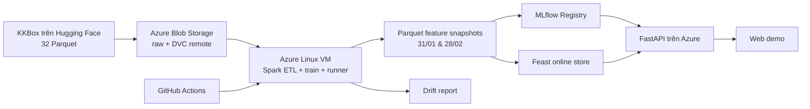

# Kịch bản thực hiện, chụp bằng chứng và bảo vệ đồ án KKBox trên Azure

Ngày lập: 04/11/2026. Đây là **kế hoạch thực hiện**, không phải biên bản đã chạy cloud. Chỉ đánh dấu hoàn thành khi có lệnh chạy, đầu ra, ảnh màn hình và số liệu đối chiếu cùng một phiên. Đọc thêm [quyết định dữ liệu](KKBOX_DECISIONS_2026-11-03.md), [runbook](KKBOX_RUNBOOK.md), [trạng thái local](LOCAL_PREP_STATUS_2026-11-04.md) và [API contract](../contracts/api_contract.md).

## 0. Phạm vi và điểm dừng Azure

- Chọn nhánh **Phân tích dữ liệu** (3 điểm) trong rubric. Các yêu cầu website bán hàng 4 trang và dashboard SaaS 4 report thuộc hai nhánh thay thế, không phải tiêu chí cần làm thêm cho đề tài này.
- Chưa có phiên xử lý toàn bộ 32 file trên Azure, chưa có API cloud, runner Azure hay chi phí thực tế. Không sử dụng metric Kaggle/REES46 hoặc pilot làm kết quả cuối.
- Số dư credit đã có ảnh do chủ dự án cung cấp; mức hiện tại **dưới 75 USD**, nên điều kiện đã giao “chỉ tạo tài nguyên trả phí khi credit thực tế ít nhất 75 USD” **chưa đạt**. Công thức `min(50, credit còn lại - 25)` USD chỉ là giới hạn dự toán nếu chủ dự án sau này thay đổi điều kiện này. Lưu ảnh số dư riêng, không commit ảnh chứa thông tin subscription. Cần xác nhận lại số dư ngay trước ngày chạy vì số dư có thể đổi.
- **Dừng trước mọi thay đổi Azure**: đăng ký resource provider, tạo budget/storage/VM/region thứ hai, cấp quyền, triển khai hoặc chạy job trên Azure đều cần chủ dự án quyết định. Chỉ đọc quota, giá, credit đã được cho phép; hiện quota Compute ở Southeast Asia chưa xác minh được vì provider chưa đăng ký. Không xem báo giá niêm yết là chi phí đã phát sinh.

## 1. Câu chuyện xuyên suốt để trình bày

> Bài toán là dự đoán khách hàng **KKBox ngừng gia hạn thuê bao nhạc**, không phải churn viễn thông. Đầu vào gốc gồm 4 bảng Parquet về thành viên, giao dịch, ngày nghe và nhãn churn; 32 file, tổng 7.522.254.856 byte theo manifest footer. Sau khi xử lý đủ file, Spark tạo 12 feature tại hai mốc thời gian. Train/validation dùng thông tin đến 31/01/2017 để dự đoán nhãn tháng 02; test dùng thông tin đến 28/02/2017 cho nhãn tháng 03. Model được ghi MLflow, feature được phục vụ qua Feast, API nhận `subscriber_key` dạng chuỗi và `as_of_date`, Web hiển thị xác suất, dự đoán, mức rủi ro, version. DVC và GitHub Actions tái lập luồng; Azure lưu trữ/chạy/triển khai và cung cấp số liệu hiệu năng, chi phí.

**Phân loại dịch vụ:** Azure VM và managed disk = IaaS; Azure Blob = dịch vụ lưu trữ quản lý (PaaS/storage service); GitHub/GitHub Actions = SaaS. Spark, DVC, Feast, MLflow và FastAPI là **phần mềm chạy trên VM**, không tự biến thành dịch vụ Azure PaaS. Thiết kế hiện tại không có FaaS; không nhận điểm FaaS của nhánh Web nếu chưa triển khai Azure Functions. Cần ghi rõ region/SKU, loại disk, loại Blob và điểm cuối API thực tế trên sơ đồ báo cáo sau khi triển khai.

## 2. Bằng chứng đã có và còn thiếu

| Mục | Hiện trạng ngày 04/11 | Bằng chứng sẵn có / điều kiện hoàn thành |
| --- | --- | --- |
| Nguồn và nhãn | Đã xem footer/schema 32/32; có hai kỳ nhãn | `docs/experiments/kkbox_parquet_manifest.json`, `kkbox_label_quality.json`; vẫn phải đo lại sau tải full |
| ETL | Pilot 6/32 file, cohort 1/1000 đã chạy | `kkbox_pilot_etl_audit.json`; **không chứng minh >4 GB đã xử lý** |
| Model/Feast/API/Web | Chạy local trên pilot; Web KKBox mới đã thử trên browser | `kkbox_pilot_model_report.json`, `kkbox_feast_pilot_report.json`, HTTP 200/404; chưa có kết quả full/cloud |
| CI | Test synthetic trên GitHub Actions đã chạy | [Run CI đã thành công](https://github.com/chinhpui23th07/Customer-Churn-Prediction-IS402.R11/actions/runs/41847833644); không thay cho full pipeline |
| Full runner/Blob/API Azure | Mới có cấu hình hoặc kế hoạch | Cần run thành công, URL, log, ảnh và đối chiếu output |
| Drift | Đã có mã và report pilot | Cần report trên full feature; đây là drift giữa hai kỳ lịch sử, chưa phải monitoring production liên tục |

## 3. Rubric: Giới thiệu bài toán — 1,5 điểm

### 3.1 Loại bài toán và loại dữ liệu — 0,5 điểm

**Làm:** ghi nguồn dữ liệu, giấy phép/điều khoản, sơ đồ 4 bảng và định nghĩa `is_churn` (1 = churn, 0 = tiếp tục). Nêu bài toán chính là **xử lý + phân tích tiên đoán**, có lưu trữ, pipeline và giao diện phụ trợ. Làm bảng nguồn → cột khóa → số dòng → vai trò: `member`, `subscription_transaction`, `listening_day`, `churn_label`.

**Ảnh/số liệu:** `01_source_dataset.png` (dataset card), `02_manifest_32_files.png` (tổng byte/row và schema), `03_label_quality.png` (hai kỳ nhãn). Ảnh nguồn chỉ là bằng chứng metadata; ảnh xử lý thực tế phải lấy từ cloud run.

**Nói với thầy:** “Input model không phải 7,52 GB thô được đưa thẳng vào thuật toán. Spark đọc toàn bộ nguồn, join và tổng hợp theo khách hàng/cutoff thành feature. Nhãn đã có trong bảng churn_label, không tự gán từ dữ liệu nghe nhạc.”

### 3.2 Kích thước >4 GB, RAM, local so với cloud — 0,75 điểm

**Làm:** sau khi tải đủ trên Azure, ghi SHA-256/byte/row từng file, tổng chính xác, output ETL và log Spark; lưu cùng commit và dataset revision. Đo **cùng một workload** trên máy local và Azure: cùng 32 file nếu local đủ tài nguyên; nếu không thì cùng 6 file cho so sánh tốc độ, còn bằng chứng >4 GB lấy từ Azure full run riêng. Script `scripts/kkbox_benchmark_read.py` chỉ đo đọc file theo manifest; thời gian ETL Spark phải đo riêng. Mỗi ca chạy tối thiểu 3 lần, ghi cold/warm cache, CPU/RAM, disk, region, số core, Spark partitions, start/end UTC, elapsed seconds, peak memory, bytes đọc/ghi. Tính `throughput_MBps = bytes thực đọc / 1e6 / elapsed_seconds` và speedup `t_local / t_cloud`; không gộp thời gian tải mạng với thời gian ETL nếu một bên dùng dữ liệu đã lưu sẵn.

**Ảnh/số liệu:** `04_azure_raw_32_files.png`, `05_spark_full_run.png`, `06_local_vs_azure_table.png`. Đưa bảng cấu hình máy và bảng số đo thật vào báo cáo; ghi rõ mỗi bảng đo cái gì. **Chưa có** số đo này.

**Nói:** “Tổng dung lượng nguồn lớn hơn 4 GB là điều kiện dữ liệu; để chứng minh xử lý lớn, em đối chiếu input_file_count = 32 và input_bytes của audit với log Spark, rồi chỉ output snapshot và thời gian thực tế.”

### 3.3 IaaS/PaaS/FaaS/SaaS — 0,25 điểm

**Làm:** dùng bảng phân loại ở mục 1, thêm tên resource/region thật khi có. **Ảnh:** `07_azure_resources_region.png`, `08_github_actions.png`. **Nói:** “VM cấp hạ tầng tính toán; Blob lưu dữ liệu; GitHub Actions điều phối CI/CD. MLflow/Feast do nhóm vận hành trên VM.”

## 4. Rubric: Cơ sở lý thuyết — 1,5 điểm

### 4.1 Định dạng lưu trữ — 0,5 điểm

**Làm:** giải thích Parquet dạng cột và nén Zstandard của nguồn, schema/footer, lợi ích projection/predicate pushdown; snapshot feature cũng lưu Parquet. Giải thích Blob object storage khác disk của VM; DVC lưu con trỏ/version trong Git và object trong remote sau khi cấu hình. Vẽ sơ đồ khóa `(subscriber_key, label_period)`; `subscriber_key` uint64 gửi qua JSON **string** để không mất chính xác.

**Ảnh:** `09_parquet_schema_footer.png`, `10_dvc_remote_version.png` (chỉ sau push/pull thật). **Nói:** “DVC version hóa dữ liệu/model artifact; Azure Blob giữ byte, Git lưu metadata. Không đưa 7,52 GB raw lên GitHub.”

### 4.2 Thuật toán xử lý — 0,5 điểm

**Làm:** mô tả 4 bước cụ thể: kiểm tra manifest → Spark join và tổng hợp theo cutoff → train/validation tháng 02, final test tháng 03 → tra feature/model khi API dự đoán. Trình bày quy tắc chống leakage: chỉ dùng giao dịch/log có ngày không sau cutoff, `is_churn` và ID không nằm trong feature vector. Giải thích LR/XGBoost được so bằng validation PR-AUC; threshold/risk lấy từ validation và lưu với model; báo cáo test tháng 03 chỉ sau khi khóa lựa chọn model.

**Ảnh:** `11_etl_dag.png`, `12_mlflow_runs.png`, `13_temporal_split.png`. **Nói:** “Final test khác thời gian với train; đây là kiểm tra khả năng áp dụng sang kỳ kế tiếp. API hiện là historical replay cho năm 2017.”

### 4.3 Dịch vụ cloud — 0,5 điểm

**Làm:** mỗi dịch vụ một dòng gồm chức năng, SKU/region, dữ liệu vào/ra, ước tính và chi phí thực tế: Blob raw/remote; Linux VM + disk cho Spark/runner/API; Azure Monitor/Cost Management nếu bật; GitHub Actions (SaaS). Không mô tả Redis/Container Apps/Functions là đã dùng nếu chưa triển khai.

**Ảnh:** `14_service_inventory_cost.png`, kiến trúc mục 1. **Nói:** “Em chỉ tính là dịch vụ đã dùng khi resource và lần chạy xuất hiện trên portal/log.”

## 5. Rubric: Mô hình dữ liệu — 2 điểm

### 5.1 Tốc độ đọc/ghi — 0,5 điểm

**Làm:** đo ba chặng riêng: Blob → VM (download), đọc Parquet → Spark feature (ETL), ghi snapshot/DVC remote (upload). Ghi byte, giây, MB/s, worker, region, disk và số lần lặp; lưu raw log lẫn bảng tổng hợp. Không so network download với local disk read như cùng phép đo. Nếu có cache, tách cold/warm.

**Ảnh:** `15_io_benchmark.png` (bảng p50/range và biểu đồ), `16_blob_metrics.png` nếu metrics hiện hữu. **Nói:** “Thông lượng được tính từ số byte thực chuyển, không suy từ kích thước công bố.”

### 5.2 Luồng ETL tự động — 0,5 điểm

**Làm:** sau khi có runner thật, bấm manual dispatch `kkbox_full_runner.yml` với `execute_full=true` một lần; job chạy DVC `kkbox_train_full`, `kkbox_feast_full`, `kkbox_drift_full`. Chụp trigger, runner có label `kkbox`, từng stage/log, artifacts audit. Ghi rõ đây là **tự động chạy các stage sau khi được kích hoạt thủ công**, chưa phải lịch ingest realtime. Kiểm tra run không trộn các stage Kaggle legacy.

**Ảnh:** `17_runner_online.png`, `18_actions_full_green.png`, `19_dvc_stage_audit.png`. **Nói:** “Workflow chỉ thành công nếu dữ liệu đủ 32 file, ETL full và các bước train/Feast/drift trả về thành công.”

### 5.3 Độ trễ theo region — 0,5 điểm

**Làm:** nếu được duyệt đủ quota/chi phí, đặt **cùng phiên bản API/model** ở Southeast Asia và một region thứ hai; từ một client cố định dùng `scripts/kkbox_latency_probe.py` gọi cùng payload 100 lần mỗi endpoint, bỏ warm-up, ghi median/p95/p99 và lỗi; kèm thông tin vùng của client và timestamp. Script kiểm tra hai endpoint trả cùng model/prediction và không ghi API key/subscriber key vào report. Kiểm soát DNS/TLS/cache, lấy thời gian HTTP end-to-end. Sau đo, xóa/deallocate bản thứ hai. Nếu không triển khai region thứ hai, đánh dấu tiêu chí này **chưa có bằng chứng**, không lấy ping trang Azure khác để thay thế.

**Ảnh:** `20_two_regions.png`, `21_latency_boxplot.png`. **Nói:** “Chênh lệch là đo từ một điểm khách đến hai endpoint giống nhau; kết luận chỉ áp dụng cho điều kiện thử nghiệm này.”

### 5.4 Tối ưu lưu trữ/đọc ghi — 0,5 điểm

**Làm:** trên cùng dữ liệu và VM, so (A) đọc toàn bộ cột/partition với (B) chọn cột cần cho 12 feature, lọc ngày đến cutoff và ghi Parquet có partition hợp lý. Chụp Spark plan/metrics: bytes scanned, thời gian, output bytes. Chỉ nêu cải thiện khi số đo xác nhận; nếu thêm partition thì tính cả chi phí ghi. So kích thước Parquet và CSV chỉ nếu đã tạo hai bản từ **cùng các dòng/cột**.

**Ảnh:** `22_scan_before_after.png`, `23_storage_size_before_after.png`. **Nói:** “Tối ưu được chứng minh bằng số byte đọc, thời gian, và dung lượng đầu ra; không chỉ dựa trên lý thuyết Parquet.”

## 6. Rubric: Phân tích dữ liệu — 3 điểm

### 6.1 Train model — 1 điểm

**Làm:** train full, ghi dataset revision, cutoff, số dòng train/validation/test, tỷ lệ churn, feature list, seed, phiên bản thư viện, MLflow run ID. So LR/XGBoost bằng validation; khóa lựa chọn rồi mới đánh giá tháng 03. Ghi PR-AUC cùng prevalence, ROC-AUC, precision/recall/F1 tại threshold đã chọn, confusion matrix và thời gian train. Registry version/alias `champion` chỉ sau full run đạt gate.

**Ảnh:** `24_mlflow_full_compare.png`, `25_test_metrics.png`, `26_registry_champion.png`. **Nói:** “Metric tháng 03 là kết quả cuối, không dùng ROC-AUC 0,9989 của Kaggle cũ hoặc pilot.”

### 6.2 API dùng model — 0,5 điểm

**Làm:** triển khai FastAPI trên endpoint Azure có HTTPS nếu công khai; health và `POST /v1/predictions`. Gửi một `subscriber_key` **dạng chuỗi** có snapshot và cutoff hợp lệ, xem HTTP 200; kiểm tra 404 khi không có snapshot, 422 khi sai request, 503 khi model/Feast chưa sẵn sàng. Response có `prediction`, `churn_probability`, `risk_level`, `model_version`, `feature_version`, `prediction_mode`; không gửi nhãn thật. Ẩn API key và ID thật trong ảnh công khai.

**Ảnh:** `27_api_request_response.png`, `28_api_errors.png`, `29_api_cloud_endpoint.png`. **Nói:** “API lấy feature tương ứng cutoff từ Feast và version model đã đăng ký; demo là dự đoán lại lịch sử, không phải dự đoán khách hàng năm 2026.”

### 6.3 Trực quan model — 1 điểm

**Làm:** từ báo cáo full tạo tối thiểu: biểu đồ LR/XGBoost validation PR-AUC, PR curve hoặc precision/recall theo threshold, confusion matrix test tháng 03, biểu đồ feature importance/giải thích có ghi nguồn và giới hạn. Mỗi hình có tiêu đề, đơn vị, kỳ dữ liệu, version và chú thích; không đưa thông tin cá nhân. Biểu đồ phải dùng JSON full run, không hardcode pilot.

**Ảnh:** `30_model_comparison.png`, `31_pr_curve.png`, `32_confusion_matrix.png`. Script `scripts/kkbox_make_figures.py` đã chuẩn bị hình so model, PR curve, confusion matrix và drift từ report full; hình feature importance chỉ thêm khi có phương pháp và dữ liệu đánh giá thích hợp. **Nói:** “Tỷ lệ churn thấp nên em trình bày PR-AUC cùng tỷ lệ churn nền; đây là đánh giá phân loại, không diễn giải feature importance thành quan hệ nhân quả.”

### 6.4 Web gọi API — 0,5 điểm

**Làm:** Web demo nhập `subscriber_key` dạng text và chọn `as_of_date`, gửi request đến URL API Azure, parse JSON, hiện xác suất/0-1/rủi ro/version và thông báo lỗi. Kiểm tra tab Network của browser: URL cloud, status 200, payload và response; đảm bảo không để API key cố định trong JS công khai (chọn cơ chế auth phù hợp trước triển khai).

**Ảnh:** `33_web_form_result.png`, `34_browser_network_api.png`. **Nói:** “Trang web không tự tính churn; nó gửi khóa/cutoff đến API cloud và hiển thị kết quả JSON.”

## 7. Rubric: Báo cáo, demo, quản lý dự án — 2 điểm

### Word 0,5 + PowerPoint 0,5

- **Word:** Chương 1 bài toán/rubric và nguồn; Chương 2 lý thuyết Parquet, Spark, model, cloud; Chương 3 kiến trúc và mô hình dữ liệu; Chương 4 thực nghiệm có bảng byte/row/time/metric/cost, benchmark local/cloud và region; Chương 5 kết luận, hạn chế historical replay, tài liệu tham khảo. Tất cả hình/bảng có số thứ tự, chú thích, ngày đo, commit/run ID. Theo mẫu KLTN của lớp.
- **Slides 10–12 trang:** (1) bài toán; (2) dữ liệu 7,52 GB/nhãn; (3) kiến trúc cloud; (4) cutoff chống leakage; (5) ETL/DVC; (6) benchmark; (7) model/MLflow; (8) API/Web; (9) drift/CI/CD; (10) chi phí/quota; (11) demo; (12) kết luận/hạn chế. Mỗi slide tối đa một thông điệp chính, trỏ sang phụ lục bằng chứng.
- **Ảnh:** `35_word_toc_figures.png`, `36_slides_overview.png` sau khi tài liệu được làm thật.

### Trình bày và demo — 0,5

**Kịch bản 5–7 phút:** 1 phút dữ liệu/nhãn/cutoff; 1 phút Azure architecture và 32-file full audit; 1 phút DVC/Actions runner; 1 phút MLflow chart/registry; 1 phút Web → API → Feast/model; 30 giây drift; 30 giây cost/quota. Chuẩn bị sẵn 1 ID hợp lệ riêng cho demo, không chiếu raw row; thử đường link và model trước buổi trình bày. Nếu VM đã deallocate để tiết kiệm, dùng video/ảnh/log của phiên chạy và nói rõ đó là bản ghi demo, không giả là live.

### Quản lý dự án trên cloud — 0,5

**Làm:** chụp GitHub branch/PR/commit của các thành viên, issue/project board phân công, Actions history; nếu nhiều người cùng dùng Azure thì chụp role assignment **đã che email/subscription ID**, Activity Log và resource tags. Lưu bảng quota theo region, bảng dự toán so với actual Cost Analysis. Azure Budget là cảnh báo, **không tự chặn chi**; phải theo dõi và deallocate/xóa resource khi xong.

**Ảnh:** `37_github_collaboration.png`, `38_azure_activity_iam.png`, `39_budget_actual_cost.png`, `40_quota_region.png`. Nếu không có phân công thành viên thật, không dựng ảnh giả; mô tả đóng góp qua GitHub thực tế.

## 8. Các thành phần MLOps ngoài rubric cần gắn với bằng chứng

| Thành phần | Demo cụ thể | Ảnh / số liệu |
| --- | --- | --- |
| DVC remote | `dvc remote list`, `dvc push`, kiểm tra object trên Blob, `dvc pull` trên môi trường sạch; không đưa credential vào Git | `41_dvc_push_pull.png` + hash/byte |
| Feast | Materialize snapshot full, truy vấn một ID/cutoff và đối chiếu 12 feature với offline Parquet | `42_feast_online_lookup.png` |
| MLflow lifecycle | Run ID, model version, alias `champion`, reload/rollback API đúng version | `43_mlflow_alias_reload.png` |
| Drift | PSI/KS/missingness tháng 02 so tháng 03 trên full snapshots; ghi rõ chưa là production online drift | `44_full_drift.png` |
| CI/CD | Synthetic CI xanh; full job trên runner Azure; deploy job hoặc script được chạy thật mới gọi là CD | `45_ci_cd_history.png` |
| Chi phí | Giá ước tính, giờ VM/disk, GB-month Blob, egress/transaction, actual theo resource | `46_cost_reconciliation.png` |

## 9. Trình tự làm sau khi chủ dự án quyết định Azure

1. **Preflight:** kiểm tra số dư mới, quota vCPU theo region/family, SKU capacity, báo giá VM/disk/Blob/network; trình bảng ngân sách. Điều kiện hiện hành là credit **ít nhất 75 USD** và trần chi **50 USD**, giữ 25 USD dự phòng. Nếu vẫn dưới 75 USD, dừng trước bước 2 cho tới khi chủ dự án quyết định lại. Provider `Microsoft.Compute`/`Microsoft.Network` chưa đăng ký là một điểm cần phê duyệt. Chọn region/SKU từ số liệu thật. Chưa tạo gì ở bước hiện tại.
2. **Tạo cloud tối thiểu:** Resource Group, Blob private, VM Linux đủ RAM/disk và budget alerts trong phạm vi duyệt. Gắn tag dự án/owner, ghi thời điểm bắt đầu tính phí. Cấu hình runner label `kkbox`, DVC Azure remote và quyền Blob; kiểm tra `dvc` có hỗ trợ Azure trước khi chạy.
3. **Chạy full một lần có log:** tải/kiểm tra 32 file, `dvc repro kkbox_train_full`, Feast, drift. Lưu download report, ETL audit, MLflow run/version, model report, `dvc.lock`, GitHub Actions run ID. Đối chiếu số file/byte/row/partition và schema với manifest. Không dùng sample modulus >1 trong kết quả cuối.
4. **Triển khai & benchmark:** API/Web cloud, kiểm tra HTTP và Network browser; đo I/O, local/cloud, tối ưu storage, region latency nếu được duyệt. Ghi actual cost từng chặng. Dừng/deallocate VM khi không thử nghiệm; lưu ý disk/Blob có thể tiếp tục tính phí.
5. **Đóng gói báo cáo:** đặt mỗi số liệu cạnh đường dẫn log và ảnh, cập nhật Word/PPT, diễn tập demo, rà soát khả năng tái lập. Lưu ảnh có ngày UTC/region/version, che secret và ID cá nhân. Phân biệt “đã chạy” với “cấu hình sẵn”.

## 10. Mẫu nhật ký bằng chứng cho mỗi phép đo

Lưu bảng riêng (CSV/Markdown hoặc phụ lục báo cáo) với các cột: `evidence_id`, `UTC_start`, `UTC_end`, `git_commit`, `dataset_revision`, `dvc_lock_hash`, `Azure_region`, `VM_SKU`, `vCPU`, `RAM_GiB`, `disk_type`, `input_files`, `input_bytes`, `input_rows`, `output_rows`, `output_bytes`, `elapsed_s`, `peak_RAM_GiB`, `throughput_MBps`, `model_run_id`, `model_version`, `metric_name`, `metric_value`, `actual_cost_USD`, `screenshot_path`, `raw_log_path`. Chỉ điền giá trị đo được; để trống nếu chưa đo.

**Quy tắc ảnh:** mỗi ảnh phải hiện công cụ/URL, ngày giờ hoặc run ID, region/resource khi cần, và giá trị có thể đọc được. Lưu file gốc trong thư mục bằng chứng riêng; che API key, token, email, subscription ID và subscriber key thật trước khi đưa vào repo/báo cáo công khai. Không commit Parquet raw, model chứa dữ liệu nhạy cảm, secret hay ảnh credit chưa che.

## Tài liệu kỹ thuật để trích trong báo cáo

- [Azure VM quota và capacity](https://learn.microsoft.com/azure/virtual-machines/quotas)
- [Azure Cost Management Budget](https://learn.microsoft.com/en-us/azure/cost-management-billing/costs/tutorial-acm-create-budgets)
- [DVC Azure Blob remote](https://doc.dvc.org/user-guide/data-management/remote-storage/azure-blob-storage)
- [GitHub self-hosted runner trong workflow](https://docs.github.com/en/actions/how-tos/manage-runners/self-hosted-runners/use-in-a-workflow)
- [KKBox public dataset card](https://huggingface.co/datasets/vaibhavkhurana/subscriber-retention-intelligence)
