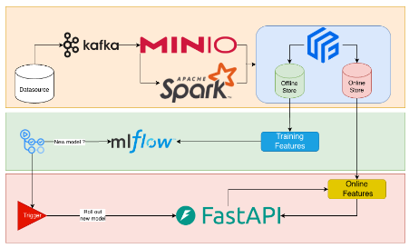
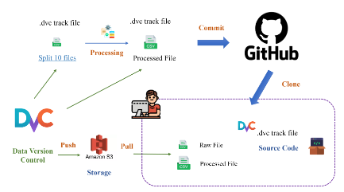
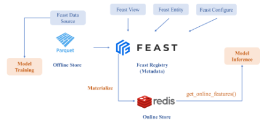
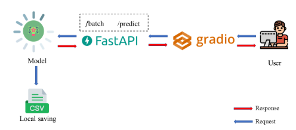
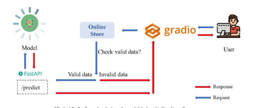
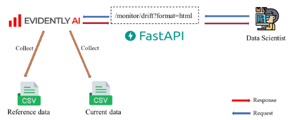
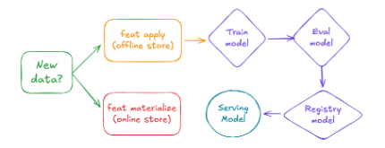
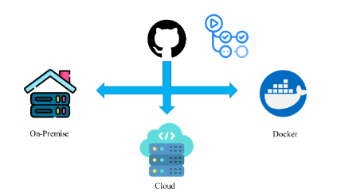

# BÀI TẬP 11: MLOPS - XÂY DỰNG HỆ THỐNG DỰ ĐOÁN KHÁCH HÀNG RỜI BỎ DỊCH VỤ (CUSTOMER CHURN PREDICTION)

> **Nguồn trích xuất gốc:** `Bài Tập Lớn (1).docx` (Đoạn P[187] - P[216])  
> **Rubric chấm điểm:** `Rubik Đánh giá bài tập quá trình & Bài tập Lớn.xlsx` (Sheet 'Bài tập Lớn', Nhóm Phân tích dữ liệu)  

---

## 1. Nội Dung Đề Bài Gốc (Trích Xuất Nguyên Văn Kèm Sơ Đồ)

**Bài tập 11: MLOps - Xây dựng hệ thống dự đoán khách hàng rời bỏ dịch vụ (Customer Churn Prediction)**

**Tập dữ liệu:**  
https://www.kaggle.com/datasets/muhammadshahidazeem/customer-churn-dataset

### Data pipeline
- Tiền xử lý dữ liệu
- Tracking data version sử dụng DVC

- Feature Store với Feast

### Training model
- Vòng đời mô hình

- Huấn luyện và Lưu mô hình: Bước chuẩn bị - Huấn luyện và Lưu mô hình
- Đánh giá mô hình
- Đăng ký mô hình và Versioning

### Serving pipeline
- Cấu hình luồng dự đoán mô hình

- Cấu hình luồng Monitor Drift

### CI/CD Pipeline

- Self-hosted Runner trong Github Actions

- Workflow CI/CD cho Pipeline MLOps

### Link tham khảo
- https://tutorial.aivietnam.edu.vn/pdf/55?fbclid=IwY2xjawPloupleHRuA2FlbQIxMABicmlkETFyMnlkRG0xSFJ4bXNJZWw5c3J0YwZhcHBfaWQQMjIyMDM5MTc4ODIwMDg5MgABHmL1LujScsxZeb_qtYkEQyxeIKbYqeoqtUMvN0qv3hNuh7i6-M_ULK41V4rf_aem_Bs8UPbbVHQQ3WclIKWXP_A

---

## 2. Thang Điểm & Tiêu Chí Đánh Giá Gốc (Rubric Excel - 10.0 Điểm)

Căn cứ theo Sheet **"Bài tập Lớn"** trong tệp rubric của Giảng viên, Đề tài 11 thuộc nhánh **Phân tích dữ liệu**:

| STT | Tiêu Chí Đánh Giá (Theo Rubric Gốc) | Điểm | Chi Tiết Yêu Cầu Của Giảng Viên |
| :---: | :--- | :---: | :--- |
| **1.0** | **Giới thiệu bài toán** | **1.5đ** | |
| 1.1 | Phân loại bài toán | 0.25đ | Giới thiệu loại bài toán thuộc nhóm: lưu trữ, thu thập, trực quan, xử lý |
| 1.2 | Loại dữ liệu | 0.25đ | Loại dữ liệu: WEB, Database, Dataset |
| 1.3 | Kích thước & So sánh tốc độ xử lý | 0.75đ | Kích thước dữ liệu - dung lượng bộ nhớ cho xử lý (>4GB, GB, MB). So sánh tốc độ xử lý trong trường hợp máy chủ truyền thống và hệ thống cloud |
| 1.4 | Phân loại thành phần Cloud | 0.25đ | Liệt kê, giới thiệu các thành phần sử dụng trong cloud thuộc nhóm nào? IaaS, PaaS, FaaS, SaaS |
| **2.0** | **Cơ sở lý thuyết** | **1.5đ** | |
| 2.1 | Cơ sở định dạng lưu trữ | 0.50đ | Trình bày được cơ sở lý thuyết về định dạng lưu trữ (Parquet, CSV, Database, Storage cloud) |
| 2.2 | Cơ sở thuật toán xử lý | 0.50đ | Trình bày được cơ sở lý thuyết về thuật toán xử lý (Lý thuyết model, Data analyst) |
| 2.3 | Chi tiết các dịch vụ Cloud | 0.50đ | Trình bày chi tiết các dịch vụ sử dụng cloud |
| **3.0** | **Mô hình dữ liệu** | **2.0đ** | |
| 3.1 | Tốc độ cho phép đọc ghi | 0.50đ | Tốc độ cho phép đọc ghi dữ liệu |
| 3.2 | Thiết lập luồng xử lý tự động ETL | 0.50đ | Thiết lập luồng xử lý dữ liệu tự động ETL (Collect data $\to$ detect lưu trữ vào trong storage cloud) |
| 3.3 | Đo độ trễ khi đặt server ở region khác | 0.50đ | Đo độ trễ delay khi thiết lập server ở vùng region khác |
| 3.4 | Giải pháp tối ưu hóa đọc ghi | 0.50đ | Các giải pháp thực hiện tối ưu hóa cho việc lưu trữ dữ liệu và cải thiện tốc độ đọc ghi dữ liệu từ vùng lưu trữ sang các ứng dụng |
| **4.0** | **Hiện thực phân tích dữ liệu** | **3.0đ** | *(Nhánh Phân tích dữ liệu)* |
| 4.1 | Huấn luyện model trên tập dữ liệu | 1.00đ | Hiện thực huấn luyện model trên tập dữ liệu |
| 4.2 | Cung cấp cơ chế API cho model | 0.50đ | Cung cấp cơ chế API cho phép sử dụng model |
| 4.3 | Trực quan hóa kết quả model | 1.00đ | Trực quan kết quả trên các tham số hoặc trên các loại model |
| 4.4 | Viết trang web sử dụng API model | 0.50đ | Viết trang web sử dụng API của model: gửi request đến hệ thống cloud và nhận kết quả trả về đồng thời parse kết quả |
| **5.0** | **Trình bày báo cáo & Quản lý dự án** | **2.0đ** | |
| 5.1 | Slide PowerPoint báo cáo | 0.50đ | PowerPoint báo cáo theo định dạng báo cáo KLTN (lỗi font chữ, chính tả, hình ảnh, số hình, số bảng biểu, tài liệu tham khảo, ...) |
| 5.2 | Báo cáo Word KLTN | 0.50đ | Word báo cáo theo định dạng báo cáo KLTN (lỗi font chữ, chính tả, hình ảnh, số hình, số bảng biểu, tài liệu tham khảo, ...) |
| 5.3 | Thuyết trình & Demo | 0.50đ | Trình bày PowerPoint & demo trực tiếp hệ thống |
| 5.4 | Quản lý dự án trên Cloud & Quotas | 0.50đ | Quản lý dự án trên môi trường điện toán đám mây: phân chia và các thành viên cùng làm trên 1 resource, chứng minh qua GitHub teamwork, thông tin chi phí quotas |
| **TỔNG**| **ĐIỂM TỐI ĐA** | **10.0đ**| |
