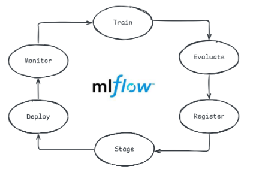

# ĐẶC TẢ KIẾN TRÚC HỆ THỐNG MLOPS DỰ ĐOÁN KHÁCH HÀNG RỜI BỎ (CHURNGUARD SPECIFICATION)

> **Mô hình kiến trúc:** MLOps Level 2 (Continuous Training & Automated Model Deployment)  
> **Bài toán:** Phân loại nhị phân dự đoán khả năng khách hàng rời bỏ dịch vụ viễn thông & tính toán giá trị rủi ro vòng đời (CLV)  
> **Tập dữ liệu chuẩn:** Kaggle Telecommunications Customer Churn Dataset (442,211 thực thể duy nhất sau khử trùng lặp)  

---

## 1. Sơ Đồ Kiến Trúc Hệ Thống MLOps Khép Kín

Hệ thống được tổ chức thành 5 phân hệ cốt lõi:
1. **Data Pipeline & Versioning:** Thu thập, khử trùng lặp, tiền xử lý streaming $O(1)$ RAM và quản lý phiên bản dữ liệu bằng DVC kết nối Azure Blob Storage.
2. **Feature Store:** Feast Dual-Store kết nối Offline Parquet Store và Online Low-Latency Store (SQLite / Azure Cache for Redis C0 SSL 6380).
3. **Model Lifecycle & Registry:** Tinh chỉnh siêu tham số Bayesian TPE (Optuna), huấn luyện tổ hợp 4 mô hình, theo dõi thực nghiệm và quản lý phiên bản với MLflow Model Registry.
4. **Model Serving & Explainability:** FastAPI REST API serving độ trễ $< 1$ms, giải thích thuộc tính SHAP bảo toàn tính cộng tính địa phương ($f(x) = \phi_0 + \sum \phi_i$), khuyến nghị giữ chân tối ưu hóa lợi nhuận kỳ vọng ($e\text{-Profits}$), định tuyến A/B testing và cơ chế Hot-Reload an toàn luồng với `MODEL_LOCK`.
5. **Continuous Monitoring & Drift Retraining:** Giám sát trôi dạt dữ liệu bằng chỉ số Population Stability Index (PSI) và kiểm định Kolmogorov-Smirnov 2 mẫu hiệu chỉnh Bonferroni, tự động kích hoạt tái huấn luyện khi `drift_share >= 0.30`.

---

## 2. Phân Hệ Data Pipeline & Versioning (DVC)

- **Thu thập dữ liệu thô:** Tải dữ liệu từ kho lưu trữ mở Kaggle (`customer_churn_dataset-training-master.csv` 22.36 MB và `customer_churn_dataset-testing-master.csv` 3.13 MB).
- **Khử trùng lặp thực thể (`customerid`):** Đảm bảo mỗi khách hàng chỉ xuất hiện duy nhất 1 lần xuyên suốt toàn bộ tập dữ liệu (tổng 442,211 khách hàng duy nhất).
- **Phân chia tập dữ liệu:** Tách tập Stratified 70% Train (309,547 bản ghi), 15% Validation (66,332 bản ghi), và 15% Test (66,332 bản ghi) bảo toàn phân phối nhãn.
- **Tính toán trung vị chống rò rỉ (`train_medians`):** Tính toán giá trị trung vị cho 7 thuộc tính số chỉ trên tập Train và áp dụng nhất quán cho Validation và Test để chống hiện tượng Pre-split Data Snooping.
- **Lưu trữ cột tối ưu:** Chuyển đổi toàn bộ sang định dạng Apache Parquet Snappy, đạt tỷ lệ nén 3.7x và tốc độ đọc 111.77 MB/s (nhanh gấp 14.41x so với CSV).
- **Theo dõi DVC:** Quản trị toàn bộ đồ thị DAG 9 giai đoạn trong `dvc.yaml` với remote storage Azure Blob Container `churnguard-datasets`.

---

## 3. Phân Hệ Feature Store (Feast)

- **Mô hình thực thể:** Khai báo thực thể `customer_id` (Int64).
- **Feature View:** Cung cấp 13 đặc trưng cốt lõi (nhân khẩu học, hành vi sử dụng dịch vụ, lịch sử thanh toán, và các chỉ số tỷ lệ phái sinh).
- **Kho lưu trữ kép (Dual-Store):**
  - **Offline Store:** Tệp Parquet `churn_features.parquet` phục vụ trích xuất đặc trưng tại điểm thời gian (Point-in-Time Correctness) khi huấn luyện.
  - **Online Store:** Bảng SQLite `online_store.db` cục bộ hoặc Azure Cache for Redis Basic C0 (cổng SSL 6380) phục vụ truy vấn thời gian thực với độ trễ $< 1$ms.
- **Chống Training-Serving Skew:** Đảm bảo 100% logic trích xuất đặc trưng khớp tuyệt đối giữa luồng tiền xử lý batch và API trực tuyến.

---

## 4. Phân Hệ Vòng Đời Mô Hình & MLflow Registry

- **Tối ưu siêu tham số Bayesian TPE (Optuna):** Thực hiện 20 trials trên không gian siêu tham số của XGBoost và Random Forest, sử dụng 5-Fold Stratified Cross-Validation tối ưu ROC-AUC.
- **Tổ hợp 4 họ mô hình:** Huấn luyện và đánh giá đối chuẩn giữa `XGBoost`, `LightGBM`, `Random Forest`, và `Logistic Regression`.
- **Tuyển chọn Champion Model:** Tự động so sánh ROC-AUC trên tập Validation và thăng hạng mô hình đạt hiệu năng cao nhất lên stage `"Production"` trong MLflow Model Registry.
- **Chẩn đoán mô hình nâng cao:** Đánh giá ma trận nhầm lẫn, đường cong ROC, đường cong độ chuẩn hóa xác suất (Calibration Curve), và phân tích thiên kiến trên lát cắt hợp đồng phi hàng tháng (Non-Monthly Subgroup Analysis).

---

## 5. Phân Hệ Phục Vụ Dự Đoán (Serving Pipeline) & Giám Sát Drift

- **Giao diện REST API FastAPI:**
  - `POST /predict`: Dự đoán thời gian thực cho một khách hàng kèm phân tầng rủi ro (`High >= 0.70`, `Medium [0.40, 0.70)`, `Low < 0.40`).
  - `POST /batch_predict`: Dự đoán hàng loạt (tối đa `MAX_BATCH_SIZE = 1000`) xử lý ma trận số hóa nhanh chóng.
  - `POST /upload_csv_predict`: Tiếp nhận tệp CSV, tiền xử lý và gắn nhãn dự đoán xuất ra định dạng phân tích.
  - `GET /predict/customer/{customer_id}`: Tự động truy vấn đặc trưng từ Feast Online Store và thực hiện suy luận.
- **Giải thích XAI bằng SHAP:**
  - Trích xuất giá trị kỳ vọng nền tảng $\phi_0$ (Base Value).
  - Phân tích đóng góp hai chiều của từng đặc trưng: $\phi_i > 0$ (yếu tố làm tăng nguy cơ rời bỏ) và $\phi_i < 0$ (yếu tố bảo vệ, làm giảm nguy cơ rời bỏ).
  - Fallback linh hoạt sang LinearExplainer nếu mô hình không hỗ trợ cấu trúc cây.
- **Khuyến nghị giữ chân $e\text{-Profits}$:** Tối ưu hóa hàm lợi nhuận kỳ vọng $\Pi_i = p_i \cdot \alpha \cdot \text{CLV}_i - C_{\text{offer}}$ dựa trên tổng chi tiêu (`total_spend`), loại hợp đồng (`contract_length`), và thời gian gắn bó (`tenure`).
- **Thực nghiệm A/B Testing:** Phân luồng khách hàng qua hàm băm `MD5(customer_id) % 100` (80% Model A / 20% Model B) và kiểm định thống kê Welch's t-test độc lập.
- **Cơ sở dữ liệu SQLite WAL:** Ghi nhận nhật ký suy luận thời gian thực với cấu hình `PRAGMA journal_mode=WAL; PRAGMA synchronous=NORMAL; busy_timeout=5000;`.

---

## 6. Phân Hệ Giám Sát Trôi Dạt Dữ Liệu & Tái Huấn Luyện Tự Động

- **Chỉ số Độ ổn định Quần thể (Population Stability Index - PSI):**
  $$\text{PSI} = \sum_{b=1}^B (P_b - Q_b) \ln\left(\frac{P_b + \epsilon}{Q_b + \epsilon}\right)$$
  - Phân chia bin tại trung điểm giữa các giá trị phân biệt đối với biến rời rạc nhị phân/tam phân.
  - Phân chia bin theo phân vị tham chiếu đối với biến liên tục.
  - Áp dụng ngưỡng kẹp $\epsilon = 10^{-4}$ chống chia cho 0.
- **Kiểm định Kolmogorov-Smirnov 2 Mẫu:**
  $$D_{\text{KS}} = \sup_x |F_{\text{ref}}(x) - F_{\text{curr}}(x)|$$
  - Hiệu chỉnh đa giả thuyết Bonferroni: $\alpha_{\text{Bonferroni}} = \frac{0.05}{13} \approx 0.003846$.
- **Ngưỡng kích hoạt Retrain:** Khi tỷ lệ đặc trưng trôi dạt $\text{drift\_share} \ge 0.30$, hệ thống tự động ghi cờ cảnh báo và kích hoạt pipeline huấn luyện lại thông qua tiến trình nền có khóa đồng bộ `RETRAIN_LOCK`.

---

## 7. Phân Hệ Tự Động Hóa CI/CD & Điện Toán Đám Mây

- **GitHub Actions Pipeline:**
  - Kiểm tra chất lượng mã nguồn và giới hạn cứng $\le 400$ dòng/tệp.
  - Thực thi toàn bộ 130 bài kiểm thử tự động (Unit test, Integration test, Adversarial test).
  - Cổng kiểm soát chống dữ liệu giả mạo (Anti-Mockup Gate): `! git grep -iE "TODO: mock|fakeData|dummyData|simulateTx" -- src/`.
  - Đóng gói container Docker và kiểm thử tính toàn vẹn.
- **Cấu hình Hạ tầng Đám mây (Infrastructure-as-Code):**
  - Cung cấp mã nguồn triển khai tự động qua Terraform (`deploy/azure/main.tf`) và Azure Resource Manager (`deploy/azure/arm_template.json`).
  - Dịch vụ mục tiêu: Azure Container Apps Serverless (1.0 vCPU, 2.0 GiB RAM), Azure Cache for Redis Basic C0 (SSL 6380), Azure Container Registry (ACR), và Azure Blob Storage Hot Tier.
  - Dự toán FinOps TCO hàng tháng: **$74.67 / tháng** (với ngưỡng cảnh báo ngân sách $100.00 / tháng).
