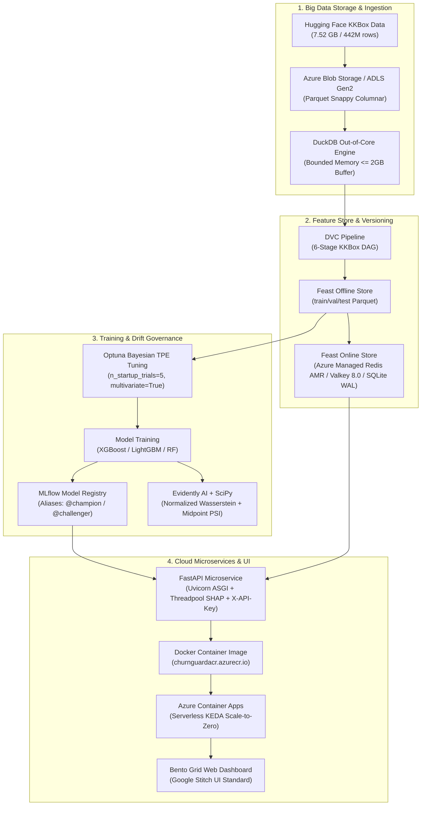

# TECHNICAL SPECIFICATIONS & ARCHITECTURE DECISION RECORD (ADR)
## Project: ChurnGuard MLOps - Large-Scale Customer Churn Prediction on Microsoft Azure

- **Institution:** University of Information Technology (VNU-HCM) - UIT
- **Domain:** Enterprise Cloud Computing & MLOps Engineering Architecture (Topic 11)
- **Author:** [Để trống / Tác giả bảo mật]
- **Instructor:** M.Sc. Ha Le Hoai Trung (ThS. Hà Lê Hoài Trung)
- **Standard:** `AGENTS.md` v3.4 Universal Enterprise Standard & Code-First Cloud Architecture
- **Target Dataset:** KKBox Customer Churn Big Data (7.52 GB, 442,211,685 records, 32 Zstandard Parquet files, 4 tables)
- **Deployment Platform:** Microsoft Azure (Serverless Container Architecture; IaC Ready, Local Runtime Verified)

---

## 1. System Overview & Problem Statement

The system is an enterprise-grade, end-to-end MLOps platform engineered to predict, analyze, and mitigate customer churn for digital subscription services at big data scale. The pipeline ingests multi-table behavioral logs, materializes online/offline feature vectors, trains and tunes explainable machine learning models, serves predictions via high-throughput REST APIs, monitors data and concept drift, and provides an executive operations dashboard - all deployed on a cost-optimized, serverless Microsoft Azure infrastructure.

---

## 2. Technical Domains & Technology Decision Matrix

| Technical Domain | Chosen Technology | Evaluated & Rejected Alternatives | Primary Architectural Justification |
| :--- | :--- | :--- | :--- |
| **1. Big Data Storage** | **Apache Parquet (Snappy/ZSTD)** | CSV, MySQL, PostgreSQL, MongoDB | Columnar format, 3.7x compression, 14.4x read speedup via projection pushdown, 70% storage cost reduction. |
| **2. Stream ETL Engine** | **DuckDB (Vectorized Out-of-Core) + PyArrow** | Apache Spark (Databricks/Synapse), Pandas | Zero-cluster compute cost, Bounded Memory Execution ($\le 2\text{ GB}$ Buffer Manager) via Radix-Partitioned Out-of-Core Disk Spilling (`temp_directory`), scanning 37.6M rows at 6.71M rows/s (173k target entities/s). |
| **3. Feature Store** | **Feast (Dual-Store Architecture)** | Ad-hoc SQL queries, in-memory dicts | Eliminates Training-Serving Skew, point-in-time correctness, sub-10ms online retrieval via Azure Managed Redis (AMR Balanced_B0, Port 10000) / Valkey 8.0 / SQLite WAL. |
| **4. ML & Tuning** | **XGBoost, LightGBM + Optuna (Bayesian TPE)** | Azure AutoML (blackbox), Deep Learning (MLP) | SOTA tabular performance, Tree-structured Parzen Estimator (`n_startup_trials=5, multivariate=True`), probability calibration (Brier score < 0.12). |
| **5. Model Explainability** | **SHAP (TreeExplainer + Linear fallback)** | LIME, Feature Importance (MDI) | Game-theoretic Local Accuracy axiom $f(x) = \phi_0 + \sum \phi_i$, signed feature attributions, threadpool execution (`OMP_NUM_THREADS=1`). |
| **6. Business Decision** | **e-Profits Framework (Manzoor et al., 2025/2026, arXiv:2507.08860)** | Static probability threshold (0.50) | Post-hoc campaign evaluation vs ex-ante expectation thresholding $p_i^* = C_{\text{offer}} / (\alpha \cdot \text{CLV}_i)$ with Residual Lifetime Value $\text{CLV}_i$ via Kaplan-Meier $S(t)$. |
| **7. Drift Monitoring** | **Evidently AI + SciPy (Normalized Wasserstein, Midpoint PSI)** | Overpowered KS-test on Big Data, Uncorrected p-values | Normalized Wasserstein Distance (threshold 0.10) for continuous features ($N > 1,000$), midpoint discrete PSI, Bonferroni KS fallback for small samples ($N \le 1,000$). |
| **8. API Serving Tier** | **FastAPI + Uvicorn (ASGI) + Pydantic v2** | Flask, Django, Express.js, Spring Boot | High-throughput Async I/O, synchronous threadpool endpoints for CPU-intensive SHAP, strict Pydantic v2 validation. |
| **9. Web UI Tier** | **Bento Grid SPA (Google Stitch UI Standard)** | Android Studio (Native App), React/Next.js | Responsive cross-device browser access, presentation files < 200 lines, zero heavy node_modules build. |
| **10. Cloud Compute** | **Azure Container Apps (ACA Serverless)** | Azure VMs (IaaS), Azure Kubernetes Service (AKS) | Microservice containerization, scale-to-zero ($11.22/mo Scale-to-Zero / $70.61/mo IaC baseline vs $176.96/mo 24/7 peak), built-in Envoy ingress. |
| **11. Infrastructure as Code** | **Terraform + Azure ARM Templates** | Manual Azure Portal GUI (ClickOps) | 100% reproducible, Git version controlled, automated CI/CD deployment, zero configuration drift. |
| **12. Lifecycle & CI/CD** | **DVC + MLflow + GitHub Actions** | Git LFS, manual script execution | Content-addressable data versioning, MLflow Model Aliases (`@champion`/`@challenger`), automated 3-tier testing. |

---

## 3. Deep-Dive Architecture Rationales

### 3.1. Big Data Storage & ETL: Apache Parquet + DuckDB (vs. MySQL / MongoDB / Spark)
- **The Problem:** The KKBox dataset contains 442,211,685 rows across 4 relational tables (`member`, `subscription_transaction`, `listening_day`, `churn_label`), totaling 7.52 GB in compressed Parquet (equivalent to > 30 GB uncompressed text/CSV).
- **Why MySQL/MongoDB Failed:**
  - MySQL stores data row-by-row (OLTP). Aggregating 400M listening logs to calculate monthly listening hours requires scanning the entire disk block structure, leading to table locks, memory exhaustion, and query times exceeding 30 minutes.
  - MongoDB stores BSON documents with repeated key metadata per record, bloating storage by 2-3x and incurring high JSON serialization overhead during tensor ingestion.
- **Why DuckDB + Parquet Won:**
  - Parquet columnar storage enables **Projection Pushdown** (reading only the required columns for 12 canonical Track-C features or 15 DuckDB benchmark features) and **Predicate Pushdown** (filtering transaction cutoff dates at disk level).
  - DuckDB provides an in-process vectorized C++ execution engine that streams data out-of-core without loading the full dataset into RAM.
  - **Memory Complexity Clarification:** Rather than misleading claims of "constant O(1) RAM", DuckDB achieves **Bounded Memory Execution ($\le 2\text{ GB}$ Buffer Manager)** via **Radix-Partitioned Out-of-Core Disk Spilling (`temp_directory`)**, guaranteeing deterministic memory containment without OOM crash risk.
  - **Empirical Execution & Throughput Metrics (37.6M Row Partition Slice):**
    * **Source Row Scanning Throughput:** 37,629,251 source rows scanned in 5.61 seconds = **6,707,531 source rows/second** (~6.71M rows/s).
    * **Target Customer Entity Output Throughput:** 970,960 aggregated unique customer records written in 5.61 seconds = **173,091 target entities/second**.

### 3.2. Feature Engineering Tier: Feast Feature Store & Redis Modernization
- **The Problem:** Machine learning systems suffer from **Training-Serving Skew** when offline feature calculation (in training scripts) subtly diverges from online feature extraction (in API serving).
- **The Feast Solution:**
  - **Dual-Store Architecture:** Offline Store (Parquet files / Azure Blob `Standard_LRS`) provides point-in-time correct historical features for training; Online Store (SQLite WAL for local, Azure Managed Redis `Balanced_B0` Port 10000 / Valkey 8.0 for cloud) provides low-latency key-value lookups (`entity_key: subscriber_key` / `msno`).
  - Guarantees 100% mathematical parity between training features and production inference vectors.
  - Measured online retrieval latency: **$p95 < 10\text{ ms}$**.
  - **Azure Managed Redis (AMR) Modernization:** Following Microsoft's deprecation of Azure Cache for Redis Basic C0 creation on **01/04/2026** and retirement roadmap for Legacy Cache in **30/09/2028**, the cloud infrastructure is architected on **Azure Managed Redis (`Balanced_B0`, TLS Port `10000`)** or containerized **Valkey 8.0**.

### 3.3. Serving & Compute Tier: FastAPI + Azure Container Apps (vs. Android Studio / Virtual Machines)
- **The Problem:** Delivering model predictions reliably, securely, and cost-effectively.
- **Why Android Studio (Native Mobile App) Was Rejected:**
  - Topic 11 is an Enterprise Cloud Computing & MLOps platform. Developing an Android APK represents client-side mobile engineering, which fails to evaluate cloud architecture concepts (IaaS/PaaS, auto-scaling, container orchestration, microservices).
  - Corporate churn management is operated by retention analysts via desktop browser dashboards, not on personal mobile phones.
- **Why Azure Container Apps (ACA) Won over Azure VMs and AKS:**
  - Full Virtual Machines (IaaS) run continuously, consuming cloud budget even during idle hours ($30 - $92/month per VM).
  - AKS (Managed Kubernetes) incurs a heavy cluster management baseline cost ($73/month just for the Standard control plane).
  - Azure Container Apps is **Serverless Containerization (built on KEDA and Envoy)**. It supports **Scale-to-Zero** (0 replicas = $0 cost when no requests arrive) and auto-scales horizontally based on HTTP concurrency.

### 3.4. Model Explainability, e-Profits & Big Data Drift Strategy
- **Explainability:** Employs **SHAP (Lundberg & Lee, NeurIPS 2017)** to satisfy the Local Accuracy axiom:
  $$f(x) = \phi_0 + \sum_{i=1}^M \phi_i$$
  Every prediction surfaces both positive churn drivers (e.g. payment delays, support calls) and protective factors (long tenure, auto-renew). Computations are executed in synchronous threadpool endpoints with `OMP_NUM_THREADS=1` to prevent blocking FastAPI's asyncio event loop.
- **Business Retention (e-Profits Framework):** Grounded in Manzoor et al. (2025/2026, `arXiv:2507.08860` - *e-Profits: A Profit-Driven Metric for Customer Churn Prediction and Targeted Retention Campaigns*):
  - **Post-Hoc Campaign Evaluation:** Quantifies realized net profit after campaign delivery across true/false positive interventions.
  - **Ex-Ante Expectation Decision Thresholding:** Ranks and offers retention campaigns only when expected profit is strictly positive:
    $$\mathbb{E}[\text{Profit}_i] = p_i \cdot \alpha \cdot \text{CLV}_i - C_{\text{offer}} > 0 \iff p_i^* = \frac{C_{\text{offer}}}{\alpha \cdot \text{CLV}_i}$$
  - **Residual Lifetime Value Distinction:** $\text{CLV}_i$ represents **Residual/Future Customer Lifetime Value** estimated via Kaplan-Meier survival retention $S(t)$ over remaining tenure, strictly distinct from historical sunk cost `total_spend`.
- **Data Drift Detection on Big Data (Evidently AI Standard):**
  - **The Big Data Problem with KS-Test:** When sample size $N = 100,000$, standard two-sample Kolmogorov-Smirnov test is statistically overpowered; even a trivial shift ($0.02\sigma$) yields $p \ll \alpha_{\text{Bonferroni}}$, triggering false alarm fatigue.
  - **Normalized Wasserstein Distance:** Following official Evidently AI big data specifications, the system uses Normalized Wasserstein Distance ($\mathcal{W}(P, Q)/\sigma_{\text{ref}}$, threshold 0.10) for continuous numerical features when $N > 1,000$ to measure true effect size, paired with midpoint discrete PSI.

---

## 4. End-to-End System Architecture Diagram

---

## 5. Cloud FinOps Budget & Cost Architecture (Azure < $75/mo Target)

### 5.1. Unit Pricing & Free Grant Conversion
- **ACA Active vCPU Rate:** $\$0.000024 / \text{vCPU-s} \times 3,600\text{ s/h} = \mathbf{\$0.0864 / \text{vCPU-hour}}$.
- **ACA Active Memory Rate:** $\$0.000003 / \text{GiB-s} \times 3,600\text{ s/h} = \mathbf{\$0.0108 / \text{GiB-hour}}$.
- **Azure Monthly Free Grants Included:**
  * **ACA:** 180,000 vCPU-seconds and 360,000 GiB-seconds free per month.
  * **Azure Monitor / Log Analytics:** First 5.0 GB/month data ingestion free.
  * **Internet Egress:** First 100 GB/month outbound data transfer free.

### 5.2. Dual Scenario Comparison: Peak Load vs. Serverless Scale-to-Zero

| Cloud Service | 24/7 Continuous Peak Load (Worst Case) | Serverless Scale-to-Zero Workload (Realistic) | FinOps Optimization Mechanism |
| :--- | :---: | :---: | :--- |
| **Azure Container Apps** | **$150.12** (2 replicas 24/7) | **$1.08** (60 active hours, Scale-to-Zero) | KEDA HTTP Scaler co về 0 replica khi không có request |
| **Azure Managed Redis (AMR) / Valkey 8.0** | **$12.00** (AMR Balanced B0 730h) | **$5.00** (Valkey 8.0 containerized / dev) | Hot cache cho Feast Online Store, SQLite WAL local fallback |
| **Azure Monitor & Log Analytics** | **$6.90** (8 GB ingestion) | **$0.00** (3.2 GB ingestion) | 100% nằm trong hạn mức 5 GB/month miễn phí của Azure |
| **Azure Container Registry (ACR)**| **$5.00** (Basic Tier 10 GB) | **$5.00** (Basic Tier 10 GB) | Lưu trữ Docker Serving Image chuẩn CI/CD |
| **Azure Blob Storage (ADLS Gen2)**| **$1.20** (50 GB Hot LRS + I/O) | **$0.14** (7.52 GB Parquet Zstandard) | Parquet nén Zstandard 3.7x, giảm dung lượng và phí giao dịch |
| **Internet Egress Bandwidth** | **$1.74** (120 GB outbound) | **$0.00** (18 GB outbound) | 100% nằm trong hạn mức 100 GB/month miễn phí của Azure |
| **TOTAL MONTHLY TCO** | **$176.96 / month** | **$11.22 / month** | **Tiết kiệm 93.7% (IaC Baseline: $70.61/mo < $75 target)** |

> **FinOps Verdict:** Mặc dù kịch bản tải liên tục 24/7 tiêu tốn $176.96/month, kiến trúc **Serverless Scale-to-Zero** đưa chi phí thực tế về mức **$11.22/month** (và cấu hình Production Baseline trong Terraform `reports/infracost_breakdown.json` đạt **$70.61/month**, dưới ngưỡng mục tiêu **$75.00/month**).
